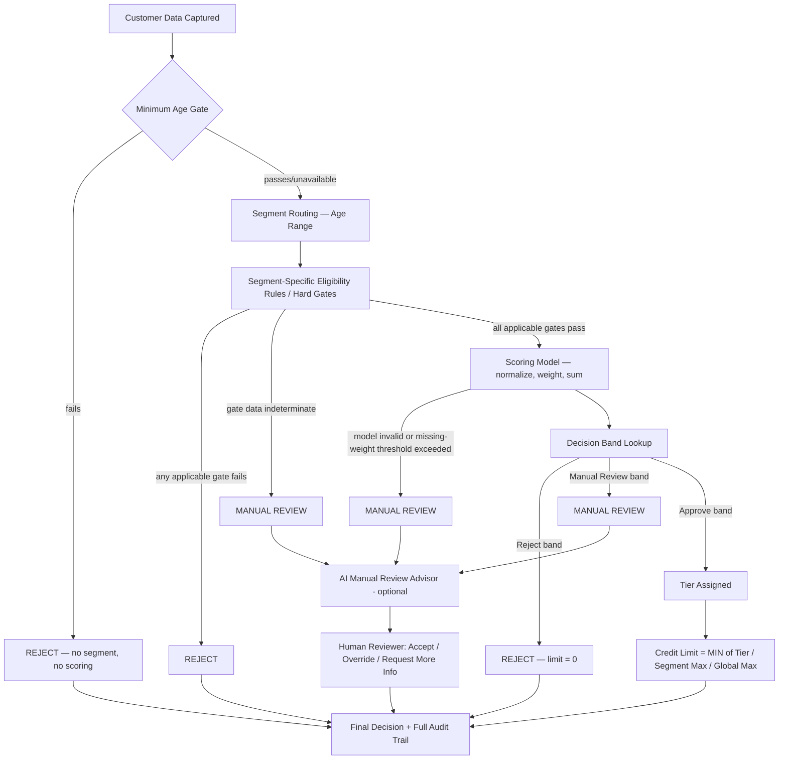
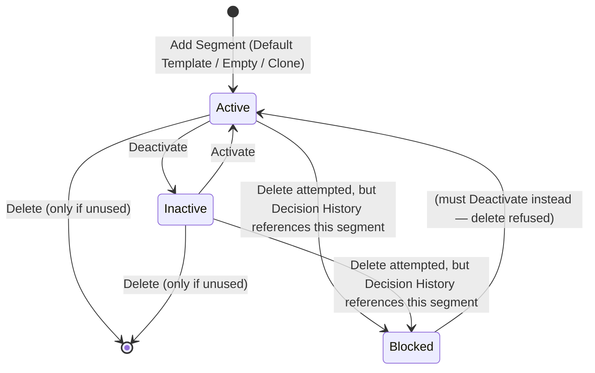
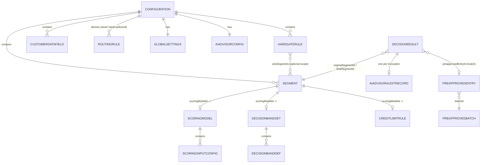

# BRDG Pay – BNPL Scoring & Decision Engine
## Current As-Built Functional & Technical Specification

**Status:** Reverse-engineered from the current working source code and application behavior. This document supersedes the original TDD — where the two disagree, the current codebase (documented here) is correct.

**Scope:** Frontend-only React/TypeScript single-page application. No backend, no database, no real external integrations. All state is persisted in the browser's LocalStorage. All third-party systems (PACI, CINET, Mobile ID) are simulated.

---

## Table of Contents

- [Executive Overview](#executive-overview)
- [PART A – Business Requirements Document](#part-a--business-requirements-document-brd)
- [PART B – Functional Specification](#part-b--functional-specification)
- [PART C – Technical Design Document](#part-c--technical-design-document-tdd)
- [PART D – Configuration Specification](#part-d--configuration-specification)
- [PART E – UI / Screen Specification](#part-e--ui--screen-specification)
- [PART F – Decision Engine Logic](#part-f--decision-engine-logic)
- [PART G – Data Model](#part-g--data-model)
- [PART H – API / Service Contracts](#part-h--api--service-contracts)
- [PART I – Sample Business Scenarios](#part-i--sample-business-scenarios)
- [PART J – Application Rebuild Specification](#part-j--application-rebuild-specification)
- [Appendix 1 – Key Differences from Original TDD](#appendix-1--key-differences-from-original-tdd)
- [Appendix 2 – Known Assumptions / Open Items](#appendix-2--known-assumptions--open-items)

---

## Executive Overview

**What it does.** BRDG Pay's Scoring & Decisioning Playground is a configurable rules-and-scoring engine for Buy-Now-Pay-Later (BNPL) credit decisions. An administrator defines customer **Segments** (e.g. Student, Young Adult, Established), and for each segment configures: who is eligible (**Eligibility Rules / Hard Gates**), how they're scored (**Scoring Model**), what a score means (**Decision Bands** → outcome + tier), and how much credit a tier is worth (**Credit Limit Rules**). A **Customer Playground** lets anyone walk a synthetic customer through a wizard and run the live decision engine end-to-end, producing a fully-explained, auditable result. Manual-review cases can additionally be routed through an **AI Manual Review Advisor** that proposes (never finalizes) a recommendation for a human reviewer.

**Main business objective.** Let a business user configure and demo an entire BNPL credit-decisioning policy — routing, eligibility, scoring, tiering, credit limits — without any code change, and validate it interactively before it would ever be wired to real identity/bureau data and a real decisioning API.

**Main user roles.**
| Role | What they do |
|---|---|
| Configuration Administrator | Defines/edits Segments, Eligibility Rules, Scoring Models, Decision Bands, Credit Limit Rules, Global Settings, AI Advisor settings, Field Catalog, Integration simulation state. |
| Demo Operator / Tester | Runs the Customer Playground with sample or custom data, inspects the full decision trace, reviews Decision History and the Dashboard. |
| Manual Reviewer | For a Manual Review outcome, runs the AI Advisor and Accepts / Overrides / Requests More Information — the human, not the AI, produces the final actionable outcome. |

**Main workflow (end-to-end):**



**Main functional modules.** Segments, Decision Engine (Eligibility Rules / Scoring Model / Decision Bands / Credit Limits, per segment), Customer Playground, Result / Decision Trace, AI Manual Review Advisor, Dashboard, Decision History, Configuration Versions, Preapproved Marketing List, Integration Simulator, Field Catalog (Customer Data Fields), Settings.

**What is configurable.** Everything under Segments and the Decision Engine page (per-segment Eligibility Rules, Scoring Model, Decision Bands, Credit Limits), the Global Maximum BNPL Limit, the Manual Review missing-weight threshold, the DTI source mode, the AI Advisor's provider/model/parameters, the Field Catalog's capability flags, the Preapproved Marketing policy's enable flag, and the Integration Simulator's per-system state and mock payload values.

**What is simulated vs. production-ready.** Everything is simulated. There is no backend, no database, no real PACI/CINET/Mobile ID connection, and (by default) no real AI model call. The "AI Manual Review Advisor" ships with a deterministic, rule-based **Simulated** provider that requires no API key; a real **Anthropic** provider exists in code but calls its API directly from the browser (no proxy), which is explicitly flagged in the UI as acceptable for local experimentation only.

---

## PART A – Business Requirements Document (BRD)

### A.1 Business Problem
A BNPL provider needs a way to define and validate credit-decisioning policy — who qualifies, how they're scored, what tier and credit limit they receive — across multiple customer segments (e.g. students vs. salaried adults), without engineering involvement for every policy tweak, and to demonstrate that policy end-to-end before it's wired to production identity/bureau systems.

### A.2 Business Goals
1. Represent an arbitrary number of customer **Segments** as data, not code — adding, renaming, or retiring a segment must never require a deployment.
2. Separate **eligibility** (binary pass/fail gate) from **scoring** (weighted 0–1 score) from **decisioning** (score → outcome/tier) from **credit limits** (tier → KWD amount) — four distinct, independently-editable responsibilities.
3. Never silently fabricate a value the business doesn't actually have (a missing CINET score is never treated as zero; a missing residency start date is never inferred from the expiry date).
4. Route genuinely ambiguous cases to **Manual Review**, optionally assisted by an **advisory-only** AI recommendation that a human must explicitly confirm or override.
5. Keep a full, explainable audit trail for every decision: what data was seen, which gates passed/failed/were skipped/were unavailable, every scoring factor's contribution, which band matched, and how the final credit limit was computed.
6. Enforce a hard ceiling (Global Maximum BNPL Limit) that no segment, tier, or AI recommendation can ever exceed.

### A.3 In Scope
- Configurable Segments, Routing (age-range mode), Eligibility Rules, Scoring Models, Decision Bands, Credit Limit Rules, Global Settings.
- A Customer Playground to run synthetic customers through the live engine.
- An advisory AI layer for Manual Review cases only, with mandatory human confirmation.
- A Preapproved Marketing List that can float a matched customer's decision to the lowest configured Approve tier (never bypassing eligibility).
- Decision History, a summary Dashboard, and Configuration Versioning (Draft/In Review/Active/Retired).
- An Integration Simulator standing in for PACI, CINET, and Mobile ID.

### A.4 Out of Scope (current implementation)
- Any real backend, database, authentication, or multi-user concurrency.
- Any real connection to PACI, CINET, Mobile ID, or a real AI provider account (a real-provider code path exists but is not a production integration — see §16 and Appendix 2).
- An "Advanced" (non-age-range) routing mode — the field exists in the data model but no advanced rule engine is implemented.
- Any autonomous AI final-decision mode — the AI Advisor is contractually advisory-only.

### A.5 Success Criteria
- An administrator can add a brand-new segment (e.g. "School Student", ages 15–17) and immediately see it appear as a fully independent Decision Engine tab and Customer Playground routing target, with zero code change.
- Every decision, regardless of outcome, can be fully explained from data already captured in the decision record — no external lookup is ever required to understand why a decision came out the way it did.

---

## PART B – Functional Specification

### B.1 Navigation / Modules (current, exact)

Sidebar is split into two sections. Routes are React Router paths; component files are under `src/pages/`.

**Primary section ("Playground"):**
| Page | Route | Purpose |
|---|---|---|
| Dashboard | `/` | Aggregate KPIs and charts over all locally-stored decisions. |
| Customer Playground | `/playground` | Wizard to build/select a synthetic customer and run the live decision engine. |
| Segments | `/segments` | Manage the dynamic list of customer segments (add/edit/clone/activate/deactivate/delete) and their age-range routing. |
| Decision Engine | `/decision-engine` | Consolidated, per-segment configuration of Eligibility Rules, Scoring Model, Decision Bands, and Credit Limits, plus the one global Global Maximum BNPL Limit field. |

**"Advanced Configuration" section:**
| Page | Route | Purpose |
|---|---|---|
| Preapproved Marketing List | `/preapproved-marketing` | Upload/manage a list of pre-registered customers who receive a decision floor. |
| Customer Data Fields | `/customer-fields` | Field Catalog — every field's type, source, and routing/hard-gate/scoring/AI-exclusion capability flags. |
| Integration Simulator | `/integrations` | Simulate PACI / CINET / Mobile ID as ONLINE / TIMEOUT / ERROR and edit their mock payloads. |
| Configuration Versions | `/config-versions` | Draft/Activate/Retire/Clone/Export/Import/Compare full configuration snapshots. |
| Decision History | `/decision-history` | Every decision ever run in this browser, most recent first, exportable. |
| Settings | `/settings` | Manual Review threshold, DTI source mode, AI Advisor configuration, demo reset. |

**Legacy routes (still functional, no longer in the sidebar — superseded by `/decision-engine`):** `/scoring-inputs`, `/hard-gates`, `/decision-bands`, `/credit-limit-rules`. These are single-segment-tabbed predecessors of the consolidated Decision Engine page; their editing logic is still live and some of their components (`BandsEditor`, `CategoriesEditor` from `ScoringInputsPage.tsx`) are directly re-used by the current Decision Engine page.

There is also a non-navigable results view: `/result/:id` (a specific decision's full trace, reached from Playground/History, never a sidebar link).

### B.2 Dynamic Segments

A **Segment** is the sole unit that ties together age-range routing, an Eligibility Rule scope, one Scoring Model, one set of Decision Bands, and one Credit Limit Rule. All of these are joined by the segment's **id**, never by its display name.

**Segment fields (current, exact — `Segment` interface):**
| Field | Type | Notes |
|---|---|---|
| `id` | `string` | Stable, unique, never reused. Every scoring model / decision-band set / credit-limit rule is keyed by this same string. |
| `code` | `string` | Short human-chosen slug, informational only — never a join key. |
| `name` | `string` | Display name — free to rename without affecting any linked configuration. |
| `description` | `string?` | Free text. |
| `product` | `string` | Product label shown in the UI (e.g. "Student BNPL"). |
| `active` | `boolean` | When `false`: never routed to (see §B.3), hidden from the Decision Engine page's default tab list (an admin can still reveal it via "Show Inactive Segments"), but its entire configuration and all historical decisions are preserved. |
| `priority` | `number` | Ascending evaluation order for routing; also the default display order everywhere. |
| `routingMode` | `'AGE_RANGE' \| 'ADVANCED'` | Only `AGE_RANGE` has an implementing engine today (see §A.4, §B.3). |
| `ageMin` | `number?` | Inclusive. |
| `ageMax` | `number?` | Inclusive; `undefined` = open-ended (no upper bound). |
| `creditAllowed` | `boolean` | If `false` (or `scoringModelId` is null), this segment never produces a credit line — decisions for it resolve to `APPROVE`/`MANUAL_REVIEW` with `creditLimit: 0` and no `creditLimitCalculation`, driven only by Eligibility Rules. |
| `scoringModelId` | `string \| null` | Join key into `scoringModels`, `decisionBands`, and `creditLimitRules` — by convention equal to `id` for every segment created via the current UI. |
| `createdAt` / `updatedAt` | `string` (ISO) | Audit timestamps on the segment record itself. |

**Segment lifecycle:**



- **Adding a segment** (`createSegment` in `engine/segmentEngine.ts`) allocates a new `id` (`seg_<uuid>`), and — if `creditAllowed` — initializes a full Decision Engine package under that same id: a `ScoringModel` (empty `inputs: []` for both "Default Template" and "Empty Configuration"; cloned `inputs` for "Clone Existing Segment"), `DecisionBandDef[]` (the standard 5-band structure for "Default Template" and clones, or `[]` for "Empty Configuration"), and a `SegmentCreditLimitRule` (`segmentMaximumKwd` from the wizard's own field, `tiers: {}` unless cloned). The new segment **immediately** appears as a Decision Engine tab and a Playground routing target — no code change, no page reload beyond React's own state refresh.
- **Editing a segment's age range** only ever patches that segment's own `ageMin`/`ageMax`/other fields — its Scoring Model, Decision Bands, and Credit Limit Rule (all keyed by `scoringModelId`, untouched by the edit) are never reset or rebuilt.
- **Renaming** only changes `name` — `id`/`scoringModelId` are immutable once created, so nothing else can break.
- **Deactivating** sets `active: false`. The storage-layer routing-rule generator (`buildRoutingRulesFromSegments`) skips inactive segments entirely, so no `RoutingRule` is produced for it — new customers can never route there. Its Scoring Model / Decision Bands / Credit Limit Rule and every past `DecisionResult` referencing it are untouched.
- **Deleting** (`deleteSegment`) is refused (`findSegmentDeleteBlockers`) if any stored decision's `originalSegmentId` or `finalSegmentId` equals the segment's id — the UI then shows: *"This segment has historical references and cannot be deleted. Deactivate it instead."* If unreferenced, delete proceeds and additionally removes the segment's `ScoringModel`/`DecisionBandDef[]`/`SegmentCreditLimitRule` **only if no other segment still shares that `scoringModelId`**, and strips the deleted segment's id out of every Hard Gate's `onlySegments` array (a gate scoped only to the deleted segment reverts to "Common" rather than vanishing).
- **Cloning** (the "+Clone" row action, or "Create From: Clone Existing Segment" in the wizard) copies the source's Scoring Model inputs, Decision Bands, Credit Limit Rule tiers, and any Eligibility Rule scoped specifically to that source segment (each cloned gate gets a fresh id and is re-scoped to only the new segment) — but never the source's `id`, `code`, `name`, or any decision history. The clone is fully independent from that point on.

### B.3 Segment Routing

**Current supported mode:** `AGE_RANGE` only. `ADVANCED` is a recognized enum value with no implementing logic (see §A.4).

Routing itself (`engine/routingEngine.ts`) is generic — it only ever evaluates a `RoutingRule[]` (a list of `{conditions: Condition[], targetSegmentId}`, evaluated by `evaluateConditions`/`evaluateOperator` from `engine/ruleEngine.ts`, which support `eq, neq, gt, gte, lt, lte, in, not_in, is_null, is_not_null`). It contains **no segment-name logic** — routing rules are always regenerated by `engine/segmentEngine.ts`'s `buildRoutingRulesFromSegments` directly from each active, `AGE_RANGE`-mode segment's `ageMin`/`ageMax`, and the storage layer re-applies this generator unconditionally on every load, so a hand-edited `routingRules` array can never drift out of sync with the segments it describes — Segments is the only place an administrator edits age ranges.

**Rule generation (pseudocode):**
```
for each segment where active == true and routingMode == 'AGE_RANGE', sorted by priority ascending:
    conditions = []
    if segment.ageMin is defined: conditions.push({field:'age', operator:'gte', value: segment.ageMin})
    if segment.ageMax is defined: conditions.push({field:'age', operator:'lte', value: segment.ageMax})
    emit RoutingRule{ id:`route_${segment.id}`, priority: segment.priority, conditions, targetSegmentId: segment.id, isCatchAll: segment.ageMax === undefined }
```

**Evaluation (`routeCustomer`, first-match wins):**
```
rules = enabled routingRules sorted by priority ascending
for rule in rules:
    if evaluateConditions(rule.conditions, customer):   // AND across all conditions; empty list always matches
        return rule.targetSegmentId
// Fallback — must never resolve to an inactive segment:
return (last ACTIVE segment in segments[]).id, or '' if none
```

**Validation (`validateSegmentRouting`, shown as a banner on the Segments page and folded into each segment's Config Status):**
- `ageMin <= ageMax` per segment.
- **No overlap** between any two active `AGE_RANGE` segments' ranges (open-ended ranges are treated as extending to `+∞` for this check) — intentional priority-based overlap is **not** supported in the current implementation.
- **No gap**: consecutive segments (sorted by `ageMin`) must have `nextSegment.ageMin <= previousSegment.ageMax + 1`, else a warning names the uncovered age span.

### B.4 Decision Engine Configuration (consolidated page)

`/decision-engine` renders one tab per **visible** segment (active, or inactive if "Show Inactive Segments" is checked), each containing exactly four numbered sections, always operating against that segment's own `scoringModelId`:

| Section | Responsibility |
|---|---|
| **1. Eligibility Rules** | Determines **whether** the customer may proceed at all — a pass/fail (or indeterminate/not-applicable) gate. Never touches score or credit amount. |
| **2. Scoring Model** | Calculates a single normalized (0–1) weighted score from the customer's available data. Never makes an approve/reject decision itself. |
| **3. Decision Bands** | Converts the final score into an **Outcome** (`APPROVE`/`MANUAL_REVIEW`/`REJECT`) and, only for `APPROVE`, a **Tier** name. Never carries a monetary amount. |
| **4. Credit Limits** | Converts **Segment + Tier** into a KWD amount, capped by the Segment Maximum and the one Global Maximum. The only place a monetary figure is ever configured. |

The page maintains one in-memory **draft** of the whole configuration; edits are staged (an "Unsaved Changes" banner appears) and committed atomically via "Save Changes" — switching segment tabs with unsaved changes prompts "Save & Switch" / "Discard & Switch" / "Cancel". Above the tabs sits exactly one Global Policy card (Global Maximum BNPL Limit) — never repeated per segment. Each segment tab also shows a compact "How This Segment Works" summary (counts of enabled Eligibility Rules, Scoring Factors, Total Weight, number of Decision Bands, Segment Maximum Credit Limit) and a **Config Status** badge (`READY` / `INCOMPLETE` / `INVALID` — see §D.4) next to its own tab label.

---

### B.5 Eligibility Rules / Hard Gates

**`HardGateRule` fields (current, exact):**
| Field | Type | Notes |
|---|---|---|
| `id` | `string` | |
| `name` | `string` | |
| `enabled` | `boolean` | |
| `priority` | `number` | Evaluation order, ascending. |
| `input` | `string` | Customer field key. |
| `operator` | `ComparisonOperator` | `eq, neq, gt, gte, lt, lte, in, not_in, is_null, is_not_null`. |
| `value` | `unknown?` | Comparison operand (unused for `is_null`/`is_not_null`). |
| `reasonCode` | `string` | Emitted when the gate **fails**. |
| `onlySegments` | `string[]?` | Empty/absent = **Common** (applies to every segment). Non-empty = applies **only** to those segment ids — filtered out entirely (never evaluated, never shown) for every other segment. |
| `dataUnavailableReasonCode` | `string?` | Emitted when the gate's input is **unavailable**. Optional — if unset, the engine falls back to the constant `DATA_UNAVAILABLE` (`DEFAULT_DATA_UNAVAILABLE_REASON_CODE` in `engine/creditLimitEngine.ts`). An empty value here is explicitly **not** a validation error. |
| `skipConditions` | `Condition[]?` | When **all** match the customer, the gate is never evaluated at all. |
| `skipDescription` | `string?` | Shown in the audit trail when skipped. |

**Result states and their effect on the decision flow:**
| Result | Meaning | Effect |
|---|---|---|
| `PASS` | Condition evaluated true (or gate not applicable to this segment at all — filtered out silently, not shown). | Continue. |
| `FAIL` | Condition evaluated false, input was present. | Immediate `REJECT` — no scoring is ever run. Multiple failed gates all contribute their reason codes. |
| `UNAVAILABLE` / indeterminate | Input was `null`/`undefined`/`''` (and operator isn't `is_null`/`is_not_null`). | Never counted as pass or fail; forces the case to `MANUAL_REVIEW` once scoring completes (see §B.6). |
| `NOT APPLICABLE` | The gate's own `skipConditions` matched the customer. | Never evaluated at all — reported distinctly from `PASS`, never shown as "Passed" when it was in fact never checked. |

**Currently configured default gates** (all seeded in `data/defaultConfig.ts`):
| Gate | Priority | Scope | Condition | Fail Reason | Unavailable Reason | Special behavior |
|---|---|---|---|---|---|---|
| Minimum Age | 10 | Common | `age >= 18` | `UNDER_MINIMUM_AGE` | `AGE_DATA_UNAVAILABLE` | Evaluated **twice**: once as a dedicated pre-routing prerequisite (an ineligible-age customer never reaches routing/scoring at all — immediate `REJECT`, empty segment), and again as an ordinary gate inside the segment's own gate list (since it carries no `onlySegments`, i.e. Common). |
| Student Nationality | 20 | Student only (`onlySegments: ['student']`) | `nationality == 'KW'` | `STUDENT_NATIONALITY_NOT_ELIGIBLE` | `STUDENT_NATIONALITY_DATA_UNAVAILABLE` | — |
| Current Delinquency | 30 | Common | `current_delinquency == false` | `CURRENT_DELINQUENCY_DETECTED` | `CINET_DELINQUENCY_DATA_UNAVAILABLE` | `current_delinquency` is itself a derived field (see §B.20). |
| Civil ID Status | 40 | Common | `civil_id_status == 'VALID'` | `INVALID_CIVIL_ID` | `CIVIL_ID_STATUS_DATA_UNAVAILABLE` | **Skipped (Not Applicable) whenever `nationality == 'KW'`** — Civil ID Status is not an eligibility condition for Kuwaiti nationals, regardless of segment. |

### B.6 Scoring Model

**Normalization methods implemented (`engine/normalization.ts`):**
| Method | Formula | Notes |
|---|---|---|
| `linear` | `clamp01((value − min) / (max − min))` | Higher raw value → higher score. |
| `linear_inverted` | `clamp01(1 − (value − min) / (max − min))` | Higher raw value → **lower** score (used for Debt-to-Income). |
| `banded` | First band where `band.min <= value < band.max` → `band.score`; below the lowest band's min → lowest band's score; at/above the top → highest band's score. | |
| `categorical` | `categories[String(value)]`, or `categories['unknown']` if the exact key is absent, or `0`. | Used for Employer Tier, Nationality, Residency Stability. |
| `boolean` | `value ? booleanScores.trueScore : booleanScores.falseScore` | Not used by any current default factor. |

All normalized scores and `clamp01` outputs are clamped to `[0, 1]`.

**Per-input fields (`ScoringInputConfig`):** `id`, `field` (customer key), `displayName`, `method`, `weight` (0–100, business/administrative percentage), `nullDefault` (0–1, used only when `missingDataBehavior === 'use_null_default'`), `enabled`, `min`/`max` (linear methods), `bands` (banded), `categories` (categorical), `booleanScores` (boolean), `missingDataBehavior`.

**Missing-data behaviors:**
| Behavior | When raw value is missing |
|---|---|
| `use_null_default` | Score the factor using its own configured `nullDefault` (0–1) — contributes normally, neither penalized nor helped beyond that fallback. |
| `exclude_and_reweight` | Drop the factor entirely from this one decision; remaining enabled/available factors' weights are proportionally re-normalized back to 100% for this decision only (the stored `weight` values are never modified). |
| `manual_review` | Same math as `exclude_and_reweight`, **plus** it unconditionally forces the overall outcome to `MANUAL_REVIEW` regardless of score. |

**Re-weighting algorithm (`engine/scoringEngine.ts::computeScore`):**
```
enabledInputs = model.inputs where enabled == true
availableInputs = enabledInputs where NOT (missing AND behavior in {exclude_and_reweight, manual_review})
excludedInputs = enabledInputs − availableInputs
totalAvailableWeight = sum(availableInputs.weight)  // falls back to 100 if this is 0

for each input in availableInputs:
    rawValue = customer[input.field]
    normalizedScore = normalize(input, rawValue)              // uses nullDefault if input.field missing but behavior == use_null_default
    effectiveWeight = (input.weight / totalAvailableWeight) * 100
    contribution = normalizedScore * (effectiveWeight / 100)
    weightedSum += contribution

finalScore = clamp(0, 1, weightedSum)
unavailableWeightPct = sum of effectiveWeight for every AVAILABLE input that used a null-default fallback (never counts excluded inputs)
manualReviewTriggered = true if any excludedInput had missingDataBehavior == 'manual_review'
```
- **Configured Weight** = the permanent, stored `weight` on the model — never changes per decision.
- **Effective Weight** = the re-normalized weight actually used for *this* decision (`null` for an excluded factor).
- **Contribution** = `normalizedScore × (effectiveWeight / 100)`, expressed as a fraction of the final 0–1 score (displayed ×100 as percentage points).
- **Final Score** = sum of all included factors' contributions, clamped to `[0, 1]`.
- **Insufficient Verified Data**: if `unavailableWeightPct` (the sum of effective weight that fell back to a *null default*, not an *excluded* factor) exceeds `globalSettings.manualReviewMissingWeightThreshold` (default **50%**), the outcome is forced to `MANUAL_REVIEW` with reason code `INSUFFICIENT_VERIFIED_DATA`.

### B.7 Default Scoring Configuration (current, exact)

**Student** (`scoringModels.student`) — total enabled weight 100%:
| Factor | Field | Method | Weight | Missing-Data Behavior | Null Default |
|---|---|---|---|---|---|
| Verified Student Allowance | `student_allowance` | banded: `[0,1)→0.0`, `[1,100)→0.40`, `[100,150)→0.70`, `[150,999999)→1.00` | 40% | use_null_default | 0.0 |
| CINET Score | `cinet_score` | banded: `[300,500)→0.20`, `[500,650)→0.45`, `[650,750)→0.70`, `[750,901)→1.00` | 35% | exclude_and_reweight | 0.3 |
| Existing Debt / Credit Exposure | `debt_to_income` | linear_inverted, min 0 max 1 | 25% | use_null_default | 0.3 |

Age, employment tenure, employer tier, salaried monthly income, and residency stability are **deliberately never** Student scoring factors — Age is a pure routing attribute, and Student status is already established by routing itself.

**Young Adult** (`scoringModels.young_adult`) — total enabled weight 100% (Residency Stability present but disabled):
| Factor | Field | Method | Weight | Missing-Data Behavior | Null Default |
|---|---|---|---|---|---|
| Monthly Income | `monthly_income` | banded: `[0,300)→0.0`, `[300,500)→0.2`, `[500,800)→0.45`, `[800,1500)→0.65`, `[1500,2500)→0.85`, `[2500,99999)→1.0` | 30% | use_null_default | 0 |
| Employment Tenure | `employment_tenure_months` | linear, min 0 max 60 | 25% | use_null_default | 0.2 |
| Employer Tier | `employer_tier` | categorical: `government→1.0, large_corp→0.85, sme→0.6, self_employed→0.5, unknown→0.3` | 20% | use_null_default | 0.3 |
| CINET Score | `cinet_score` | linear, min 300 max 900 | 15% | exclude_and_reweight | 0.3 |
| Nationality | `nationality` | categorical: `KW→1.00`, every other configured nationality code → `0.50` (each independently editable), `unknown→0.5` | 10% | use_null_default | 0.5 |
| Residency Stability | `residency_stability_category` | categorical (see §B.11) | 10% (**disabled by default**) | use_null_default | 0.35 |

Age is **not** re-scored here (its 10% weight was reassigned to Nationality — it already determined the segment via routing).

**Established Customer** (`scoringModels.established`) — total enabled weight 100% (Residency Stability present but disabled):
| Factor | Field | Method | Weight | Missing-Data Behavior | Null Default |
|---|---|---|---|---|---|
| Monthly Income | `monthly_income` | banded (identical bands to Young Adult) | 20% | use_null_default | 0 |
| CINET Score | `cinet_score` | linear, min 300 max 900 | 20% | exclude_and_reweight | 0.3 |
| Debt-to-Income | `debt_to_income` | linear_inverted, min 0 max 1 | 25% | use_null_default | 0.3 |
| Employment Tenure | `employment_tenure_months` | linear, min 0 max 120 | 15% | use_null_default | 0.3 |
| Employer Tier | `employer_tier` | categorical (identical to Young Adult) | 10% | use_null_default | 0.3 |
| Nationality | `nationality` | categorical (identical to Young Adult) | 10% | use_null_default | 0.5 |
| Residency Stability | `residency_stability_category` | categorical | 10% (**disabled by default**) | use_null_default | 0.35 |

*(Established's CINET weight was trimmed from an earlier 30% to 20% specifically to make room for Nationality's 10% without exceeding 100%.)*

Every Nationality categorical map is built at seed time by iterating every configured nationality code (`data/nationalities.ts`) and defaulting each to 0.50 except `KW → 1.00` — i.e. every country has its **own independently-editable** category entry from the start, never a single collapsed "non-Kuwaiti" bucket.

### B.8 Field Catalog (Customer Data Fields)

Every field the engine can ever see is one `CustomerDataField` record:

| Field | Type | Purpose |
|---|---|---|
| `key` | `string` | Technical key, matches the customer-record property name. |
| `displayName` | `string` | |
| `type` | `'string' \| 'number' \| 'boolean' \| 'date' \| 'enum'` | |
| `source` | `FieldSource` | One of `Customer Input, PACI / Identity Provider, CINET, Mobile ID, Internal BRDG, Commercial Registry, Derived, Mock Integration`. |
| `enabled` | `boolean` | Field exists/usable at all. |
| `visibleInPlayground` | `boolean` | Shown in the Customer Playground wizard/Review table. |
| `useForRouting` | `boolean` | Eligible to be used in a `RoutingRule` condition. |
| `useAsHardGate` | `boolean` | Eligible to be the `input` of a Hard Gate. |
| `useForScoring` | `boolean` | Eligible to be added as a `ScoringInputConfig.field` (governs only the **admin's** ability to add it as a *new* scoring factor via the UI — does not gate the engine itself, which only ever consults `ScoringModel.inputs`). |
| `required` | `boolean` | Cosmetic/administrative flag. |
| `options` / `optionLabels` | `string[]` / `Record<string,string>` | For `enum` fields. |
| `restrictedFromScoring` | `boolean?` | Legacy/older flag — permanently bars a field from being *added* as a scoring factor via the UI (currently only Gender). |
| `aiExcluded` | `boolean?` | The field's value is always stripped from the AI Manual Review Advisor's decision package, **regardless of whether the deterministic engine itself already uses it** (e.g. Nationality: scored by the deterministic engine, still excluded from AI context). Currently set on `nationality`, `gender`, `civil_status`, `address_area`, `address_governorate`. |
| `usageLabel` | `string?` | Cosmetic summary shown in the catalog UI. |

**Derived fields** (source `'Derived'`, never directly editable by the customer):
| Field | Derived from | Notes |
|---|---|---|
| `age` | `date_of_birth` | Computed on every wizard change of Date of Birth. |
| `residency_duration_years` | `residency_start_date` only | `null` if the start date is unavailable — **never** inferred from the expiry date. |
| `residency_remaining_months` | `residency_expiry_date` only | `null` if unavailable. |
| `residency_stability_category` | `residency_status` + `residency_duration_years` | `CITIZEN → citizen_or_permanent`; else bucketed by duration (`≥10y, 5–10y, 3–5y, <3y`); `unspecified` if duration is `null`. Never influenced by nationality. |
| `debt_to_income` | `monthly_debt_obligations ÷ monthly_income` | See §B.21. |
| `current_delinquency` | CINET overdue amount / open-account overdue-balance / outstanding-payments / DPD | See §B.20. |

### B.9 Decision Bands

`DecisionBandDef { id, min, max, outcome: 'APPROVE'|'MANUAL_REVIEW'|'REJECT', tier?: string }` — **never** a monetary field. Each segment owns an independent copy (editing one segment's bands never touches another's).

**Matching (`matchDecisionBand`):** sort bands by `min` ascending; find the first band where `score >= min && score < max` (min-inclusive, max-exclusive); if the score is at or above the very top band's `max` (i.e. `score === 1.0`), it belongs to that top band (its internal `max` is stored as `1.01` specifically to make this edge case min-inclusive/max-exclusive without a special case in the matcher).

**Validation (`validateBandCoverage` + `validateBandTiers`):** bands must cover exactly `[0, 1]` with **no gap** before the first band's min or after the last band's max, **no overlap** or gap between any two consecutive bands, every band's `min < max`; `REJECT`/`MANUAL_REVIEW` bands must **not** carry a `tier`; `APPROVE` bands **must** carry one.

**Current default bands** — identical structure seeded independently for every segment (`bandsFor()` in `data/defaultConfig.ts`):
| Score Range | Outcome | Tier |
|---|---|---|
| 0.00 – 0.30 | REJECT | — |
| 0.30 – 0.45 | MANUAL_REVIEW | — |
| 0.45 – 0.60 | APPROVE | Tier C |
| 0.60 – 0.75 | APPROVE | Tier B |
| 0.75 – 1.00 (inclusive) | APPROVE | Tier A |

### B.10 Credit Limit Rules

`SegmentCreditLimitRule { segmentMaximumKwd: number, tiers: Record<string, number> }`, one per `scoringModelId`, plus exactly one global `globalSettings.globalMaxBnplLimit`.

**Formula (`computeCreditLimit`):**
```
finalLimit = MAX(0, MIN( tierCreditLimit ?? ∞, segmentMaximumKwd, globalMaxBnplLimit ))   // over only the candidates that are present
```
- `REJECT` → `creditLimit = 0`, `tier = null`, no `creditLimitCalculation` object at all.
- `MANUAL_REVIEW` → **no automatic final limit** — `creditLimitCalculation = null`, `creditLimit = 0`; UI shows "Manual Review Required — No automatic credit limit is assigned until this decision is resolved to Approve."
- `APPROVE` with a Tier that has **no configured amount** in `tiers` → this is treated as a **configuration error** (`creditLimitCalculation.configError = true`, reason code `CREDIT_LIMIT_CONFIG_ERROR`) rather than silently presenting a bare `MIN(segmentMax, globalMax)` as if it were a clean approved amount.

**Validation (`validateCreditLimitRule`):** Tier C ≤ Tier B ≤ Tier A (only where both sides of a comparison are present); every configured amount ≥ 0; `segmentMaximumKwd > 0`; no tier amount may exceed `segmentMaximumKwd`; `segmentMaximumKwd` may not exceed `globalMaxBnplLimit`; every Tier actually assigned by that segment's own Decision Bands must have a valid (**> 0**) configured amount — a missing/zero amount for a live tier is flagged as a configuration error, never accepted as an intentional 0 KWD limit.

**Current default values:**
| Segment | Segment Maximum | Tier C | Tier B | Tier A |
|---|---|---|---|---|
| Student | 100 KWD | 50 KWD | 75 KWD | 100 KWD |
| Young Adult | 500 KWD | 150 KWD | 300 KWD | 500 KWD |
| Established | 500 KWD | 150 KWD | 300 KWD | 500 KWD |
| **Global Maximum BNPL Limit** | **500 KWD** | | | |

### B.11 Missing-Data Logic — Full Reference

| Mechanism | Configured where | Triggers when | Effect |
|---|---|---|---|
| `use_null_default` | Per scoring input | Raw field value missing | Scores with the input's own `nullDefault` (0–1). |
| `exclude_and_reweight` | Per scoring input | Raw field value missing | Drops the factor; remaining available factors' weights re-normalize to 100% for this decision only. |
| `manual_review` (scoring) | Per scoring input | Raw field value missing | Same math as exclude_and_reweight, **plus** forces `MANUAL_REVIEW` regardless of score. |
| Hard Gate indeterminate | Automatic — any gate whose `input` is missing | Input is `null`/`undefined`/`''` and operator isn't `is_null`/`is_not_null` | Never pass/fail; contributes `HARD_GATE_DATA_UNAVAILABLE` and forces `MANUAL_REVIEW` once scoring completes. |
| Manual Review Missing-Weight Threshold | `globalSettings.manualReviewMissingWeightThreshold` (Settings page; **default 50%**) | Sum of effective weight from **use_null_default** fallbacks (not excluded factors) exceeds the threshold | Forces `MANUAL_REVIEW`, reason code `INSUFFICIENT_VERIFIED_DATA`. |
| Integration unavailable | Integration Simulator (`TIMEOUT`/`ERROR`) | Any field owned by that integration is forced to `null` for every customer, overriding whatever the wizard entered | Downstream behavior follows whichever of the above mechanisms consumes that field. |
| Invalid Scoring Model | Enabled weights don't sum to 100% | Detected at decision time (`isModelValid`) | Forces `MANUAL_REVIEW`, reason code `SCORING_MODEL_INVALID`, `finalScore = 0`, no scoring breakdown produced. |

### B.12 Manual Review Flow

A case reaches `MANUAL_REVIEW` for any of these reasons (all mutually independent, any one is sufficient):
1. The final score falls inside a segment's configured `MANUAL_REVIEW` Decision Band.
2. Any **applicable** Hard Gate's input was unavailable (indeterminate) — never for a *failed* gate, which always produces `REJECT` instead.
3. Any scoring factor configured `manual_review` was itself missing (unconditional override, independent of score).
4. The `INSUFFICIENT_VERIFIED_DATA` missing-weight threshold was exceeded.
5. The segment's Scoring Model is invalid (enabled weights ≠ 100%).

`MANUAL_REVIEW` differs from `REJECT` in one essential way: **Reject is a confirmed negative determination** (a failed gate, or a score below the Reject band) — final, `creditLimit = 0`, never advisory. **Manual Review is an indeterminate case** — the deterministic engine explicitly declines to decide, and (optionally) the AI Advisor may propose a recommendation, but only a human reviewer's confirmation ever becomes actionable.

### B.13 AI Manual Review Advisor

**Invocation gate:** `shouldInvokeAiAdvisor(decision) = decision.decisionOutcome === 'MANUAL_REVIEW' && !decision.hardGateFailed`. Since a confirmed failed Hard Gate can *only* ever resolve to `REJECT` in this engine, the second condition is a defensive restatement of an invariant that already holds by construction — the AI is architecturally unreachable for `APPROVE` or `REJECT`.

**Provider:** configurable, `'simulated'` (default) or `'anthropic'`.
- **Simulated** — a deterministic, rule-based stand-in requiring no API key, coded to honor every guardrail below. It inspects the same decision package a real model would receive: any *critical* unavailable Hard Gate (`Current Delinquency` or `Civil ID Status`) → `REQUEST_MORE_INFORMATION`; else if the score is within 2 points of the top of its Manual Review band with no weak factors and no missing data → `APPROVE` at the lowest configured tier; else if any data is missing → `REQUEST_MORE_INFORMATION`; else → `REJECT`. Every cited factor is read directly from the supplied package.
- **Anthropic** — a real call to `POST https://api.anthropic.com/v1/messages` made **directly from the browser** (`anthropic-dangerous-direct-browser-access: true`) since there is no backend to proxy through. The API key is entered in Settings and stored in LocalStorage — explicitly flagged in the UI as acceptable for local experimentation only, never a production key.

**Configuration (`AiAdvisorConfig`, on Settings page):** `enabled` (bool), `provider`, `model` (string, e.g. `simulated-v1` or a Claude model id), `temperature` (0–1), `maxResponseTokens`, `timeoutMs`, `minConfidenceThreshold` (`LOW|MEDIUM|HIGH`), `recommendationMode` (fixed to `'ADVISORY_ONLY'` — no autonomous mode exists), and (Anthropic only) `apiKey`.

**Input package (`AiDecisionPackage`, built by `buildAiDecisionPackage`)** — deliberately minimal, no raw customer PII, no protected/demographic field (any `CustomerDataField.aiExcluded === true` is stripped from `scoringBreakdown` even if the deterministic engine itself scored it):
```json
{
  "customerId": "<decision.id — never the raw civil ID>",
  "segment": "young_adult",
  "engineResult": { "score": 0.43, "decision": "MANUAL_REVIEW", "decisionBand": "30-45%" },
  "eligibilityRules": [ { "rule": "Civil ID Status", "result": "PASS" }, { "rule": "Current Delinquency", "result": "UNAVAILABLE" } ],
  "scoringBreakdown": [ { "factor": "Monthly Income", "rawValue": 900, "normalizedScore": 0.65, "weight": 20, "contribution": 13.0, "included": true } ],
  "missingData": ["Current Delinquency"],
  "creditPolicy": { "tierLimits": { "Tier C": 150, "Tier B": 300, "Tier A": 500 }, "segmentMaximum": 500, "globalMaximum": 500 },
  "reasonCodes": ["HARD_GATE_DATA_UNAVAILABLE", "..."]
}
```

**Output schema (`AiAdvisorRecommendation`, strict):**
```json
{
  "recommendedAction": "APPROVE | REJECT | REQUEST_MORE_INFORMATION",
  "confidence": "LOW | MEDIUM | HIGH",
  "recommendedTier": "string | null",
  "recommendedLimitKwd": "number | null",
  "summary": "string",
  "positiveFactors": ["string", "..."],
  "riskFactors": ["string", "..."],
  "missingInformation": ["string", "..."],
  "reasonCodes": ["string", "..."],
  "recommendedActionReason": "string"
}
```
No other `recommendedAction` value is ever accepted.

**Guardrails (`validateAndClampAiResponse`, applied identically to both providers' output):**
- Structurally invalid JSON, or an unsupported `recommendedAction`/`confidence` enum value → the whole response is rejected outright (fails closed — never patched).
- `APPROVE` without a `recommendedTier` present in the segment's own `creditPolicy.tierLimits` → downgraded to `REQUEST_MORE_INFORMATION`.
- `recommendedLimitKwd` above `MIN(tierLimit, segmentMaximum, globalMaximum)` → **clamped down** to that ceiling, and a policy-violation note is recorded (never silently honored).
- A negative `recommendedLimitKwd` → clamped to 0.
- An `APPROVE` recommendation whose `confidence` is below the configured `minConfidenceThreshold` → downgraded to `REQUEST_MORE_INFORMATION`.

**Failure handling:** a timeout (`AbortController`, `timeoutMs`), network error, invalid JSON, or unsupported value never produces an approval or rejection — the case remains `MANUAL_REVIEW`, `recommendation: null`, and the UI shows **"AI Advisor Unavailable — Manual reviewer action required."** with a Retry button.

**Audit record (`AiAdvisorAuditRecord`, one immutable row per invocation, LocalStorage key `brdgpay.aiAdvisorAudits`):** `id`, `decisionId`, `invokedAt`, `engineScore`, `engineManualReviewReason`, `inputSnapshot` (the exact package sent), `provider`, `modelUsed`, `promptVersion` (`"v1"`), `status` (`OK|TIMEOUT|ERROR|INVALID_RESPONSE|DISABLED|NOT_APPLICABLE`), `recommendation`, `policyViolations[]`, `errorMessage?`. Reviewer fields (`reviewerUserName`, `reviewerAction: 'ACCEPT'|'OVERRIDE'|'REQUEST_MORE_INFO'`, `reviewerFinalDecision: {decision, tier, limitKwd}`, `reviewerOverrideReason`, `reviewerActionAt`) are the **only** fields ever appended after creation — the AI invocation data is never rewritten, and the original `DecisionResult` is never mutated at all. **Override** additionally requires a non-empty Override Reason before it can be submitted.

**Distinguishing the three layers:** the **deterministic engine result** (`DecisionResult.decisionOutcome/tier/creditLimit`) never changes once produced; the **AI recommendation** (`AiAdvisorAuditRecord.recommendation`) is advisory data layered alongside it; the **final human-confirmed result** (`AiAdvisorAuditRecord.reviewerFinalDecision`) is the only thing a person should act on operationally, and it is always visibly distinct from both of the above in the UI.

### B.14 Customer Playground

Three-step wizard (Identity → Employment & Financial → Review) plus one-click Sample Customers. `WizardStepFields`/`FieldInput` render only fields where `enabled && visibleInPlayground`, grouped by `FieldGroup` (`identity|employment|cinet|additional|other`). Live, read-only, non-editable previews are shown inline: Preapproved Match status, Residency Duration/Remaining/Stability, Current Delinquency, Debt-to-Income. The Review step lists every visible field with its **Source** (`Customer Input`, `PACI / Identity Provider`, `CINET`, `Mobile ID`, `Internal BRDG`, `Derived`) and masks the Civil ID.

**"RUN DECISION ENGINE"** calls `resolveCustomerRecord` (fills any wizard-blank field owned by an `ONLINE` integration from its mock payload; forces every field owned by a `TIMEOUT`/`ERROR` integration to `null` regardless of what the wizard has; re-derives residency fields, DTI, Current Delinquency, and CINET status/score availability) and then `runDecisionEngine`, saves the `DecisionResult` to Decision History, and navigates to `/result/:id` — which is where the full trace, the AI Advisor card (Manual Review only), and the What-If Simulator live. There is no separate "what-if" concept inside the Playground itself; it lives entirely on the Result page.

### B.15 Integration Simulator

Three simulated systems, each `{id, name, state: 'ONLINE'|'TIMEOUT'|'ERROR', fields: string[], mockData}`:
| System | Fields supplied | What goes `null` when TIMEOUT/ERROR |
|---|---|---|
| PACI | `date_of_birth, age, civil_id_status, civil_id_expiry_date, residency_status, residency_start_date, residency_expiry_date, nationality, employer_name` | All of the above — Age, Civil ID Status (a Hard Gate input), Nationality (a Hard Gate + scoring input), residency dates. |
| CINET | `cinet_score, cinet_score_cluster, cinet_evaluation_month, total_active_bnpl_accounts, total_monthly_bnpl_payment, total_overdue_bnpl_amount, worst_account_status, max_outstanding_payments_24m, cinet_open_accounts, monthly_debt_obligations` | All of the above — cascades into `debt_to_income` (derived, becomes `null`) and `current_delinquency` (derived, becomes `null`, making its Hard Gate indeterminate). |
| Mobile ID | `mobile_id_verified` | That one field (display-only today; not consumed by any gate/scoring/routing). |

Resolution order (`resolveCustomerRecord`): integration fill/null-out → derive residency fields → optionally mirror `monthly_debt_obligations` from CINET's BNPL payment (per Settings) → derive `debt_to_income` → derive `current_delinquency` → resolve CINET score availability from the customer's own chosen `cinet_status` (`NOT_CHECKED|AVAILABLE|TIMEOUT|ERROR`) reconciled against the CINET integration's own simulated state.

### B.16 PACI / Identity Data

| Field | Source | Derived? | Hard Gate use | Scoring use | Routing use |
|---|---|---|---|---|---|
| `date_of_birth` | PACI | No | No | No | No |
| `age` | Derived (from DOB) | Yes | Yes (Minimum Age) | No (see §B.7) | Yes (segment age-range) |
| `civil_id_status` | PACI | No | Yes (skipped for Kuwaiti) | No | No |
| `civil_id_expiry_date` | PACI | No | No | No | No |
| `residency_status` | PACI | No | No | No | No |
| `nationality` | PACI | No | Yes (Student Nationality, Civil ID skip) | Yes (Young Adult/Established, 10%) | No |
| `employer_name` | PACI | No | No | No | No |
| `residency_start_date` | PACI | No | No | No (feeds derived Residency Duration/Stability) | No |
| `residency_expiry_date` | PACI | No | Yes (available/eligible) | No (feeds derived Residency Remaining) | No |

### B.17 CINET Data

| Field | Displayed | Scored | Hard Gate input | Technical-only | Derived |
|---|---|---|---|---|---|
| `cinet_score` | Yes | Yes (all 3 segments, optional/excludable) | No | No | No |
| `cinet_score_cluster` | No | No | No | Yes (informational) | No |
| `cinet_evaluation_month` | No | No | No | Yes (informational) | No |
| `total_active_bnpl_accounts` | Yes | Yes (currently unused by any default model but flagged scoring-eligible) | No | No | No |
| `total_monthly_bnpl_payment` | Yes | Yes (flagged eligible; unused by default models) | No | No | No |
| `total_overdue_bnpl_amount` | Yes | Yes (flagged eligible; unused by default models) | No | No | Feeds `current_delinquency` |
| `worst_account_status` | Yes | Yes (flagged eligible; unused by default models) | No | No | No |
| `max_outstanding_payments_24m` | Yes | Yes (flagged eligible; unused by default models) | No | No | No |
| `cinet_open_accounts` | No (technical detail only, Integration Simulator screen) | No | No | Yes | Feeds `current_delinquency` |
| `monthly_debt_obligations` | Yes | No directly | No | No | Feeds `debt_to_income`; optionally mirrors `total_monthly_bnpl_payment` per Settings |
| `current_delinquency` | No (CINET Summary card shows it formatted) | No | Yes | No | Yes — see §B.20 |
| `cinet_status` (Customer Input, not a CINET-sourced field) | Yes | No (governs whether `cinet_score` is scored at all) | No | No | No |

### B.18 DTI (Debt-to-Income) Calculation

`utils/dti.ts::computeDebtToIncome`: **always derived**, `monthly_debt_obligations ÷ monthly_income`, rounded to 3 decimals. Returns `null` (never `Infinity`/`NaN`) if obligations are unavailable, or income is unavailable/≤ 0. Never taken as a raw CINET value, never derived from BNPL account count. `globalSettings.dtiSourceMode` (`'separate_obligation'` default, or `'bnpl_payment'`) only controls **where `monthly_debt_obligations` itself comes from** — a separate mock/editable figure, or mirrored from CINET's `total_monthly_bnpl_payment` — never a formula input on its own. `debt_to_income` is scored via `linear_inverted` (higher DTI → lower score) in Student and Established.

### B.19 Dashboard (current, exact)

`useMemo` over the full in-memory `history: DecisionResult[]` (LocalStorage, never paginated/filtered). Current widgets — **no others exist**:
- KPI tiles: Total Simulations, Approval Rate, Manual Review Rate, Reject Rate, Average Score, Average Approved Limit.
- **Decisions by Segment** — count grouped by `originalSegmentId`.
- **Tier Distribution** — count grouped by (`tier` for Approve, else the literal label `"Manual Review"` or `"Reject"`).
- **Score Distribution** — 10 fixed 10-point buckets (`0–10 … 90–100`) over `finalScore * 100`.
- **Common Reason Codes** — top 8 most frequent `reasonCodes` entries across all history.

No filters, no date range, no AI-specific metrics, no credit-limit distribution, no per-segment average-limit breakdown exist in the current implementation (see §33).

### B.20 Decision History / Audit

One row per stored `DecisionResult` (see full field list in §G.1): masked Civil ID, Age, Segment, Score, Decision badge, Tier, Limit, Config Version label. Clicking a row navigates to its full `/result/:id` trace. "Export" downloads that one decision as JSON. "Clear History" wipes the whole list after a confirm.

`current_delinquency` derivation (`utils/cinetDelinquency.ts::deriveCurrentDelinquency`): `null` if `total_overdue_bnpl_amount` itself is unavailable (never coerced to `false`); else `true` if that amount is positive, or if any `cinet_open_accounts` entry has a positive `overdueBalance`, `paymentsOutstanding`, or `dpd`; else `false`.

### B.21 Configuration Versioning

`ConfigStatus = 'DRAFT' | 'IN_REVIEW' | 'ACTIVE' | 'RETIRED'`. The "IN_REVIEW" status exists in the type but is not currently set by any UI action (no button transitions a config into it) — see §33. Actions available on `/config-versions`: **Create Draft** (clone the active config as a new Draft), **Clone** any version, **Activate** (the previous Active version is auto-retired), **Retire** the active one, **Export**/**Import** full JSON, and a side-by-side **Compare** (per top-level section: Segments, Routing Rules, Hard Gates, Customer Fields, Scoring Models, Decision Bands, Credit Limit Rules, Global Settings, Integrations — shown as "Identical"/"Different" plus a raw character-count, not a field-level diff). There is exactly one Active configuration at a time; every read (`getConfigurations`) runs the full migration/normalization chain, so an old saved config is always upgraded in memory to the current shape on load.

### B.22 Settings

| Setting | Effect |
|---|---|
| Manual Review Threshold (%) | `globalSettings.manualReviewMissingWeightThreshold`, default 50 — see §B.11. |
| Debt-to-Income Source | `globalSettings.dtiSourceMode` — see §B.18. |
| AI Manual Review Advisor | Full `AiAdvisorConfig` block — see §B.13. |
| Demo Data reset | Wipes configuration + decision history + preapproved list back to seeded defaults. |

There is no separate "Business Settings vs. Advanced/Technical Settings" split in the current UI — all Settings-page fields live on one page (see §33).

---

## PART C – Technical Design Document (TDD)

### C.1 Stack
React 19 + TypeScript, Vite 8 build tooling, React Router 7 (client-side routing only), `uuid` for id generation, `xlsx` for spreadsheet import (Preapproved List). No server, no database, no auth. All state lives in the browser's `localStorage`.

### C.2 Persistence — LocalStorage keys
| Key | Contents |
|---|---|
| `brdgpay.configurations` | `Configuration[]` — every Draft/In Review/Active/Retired version. |
| `brdgpay.decisionHistory` | `DecisionResult[]`, capped at the 500 most recent (`unshift` + `slice(0,500)`). |
| `brdgpay.aiAdvisorAudits` | `AiAdvisorAuditRecord[]`. |
| `brdgpay.preapprovedEntries` | `PreapprovedEntry[]` — deliberately separate from `configurations`, never exported/imported with it. |
| `brdgpay.preapprovedBatches` | `PreapprovedBatch[]`. |
| `brdgpay.integrationOverrides*` | Reserved prefix constant; integration state currently lives inside `Configuration.integrations`. |

### C.3 Migration-on-read pattern
`storage/localStorageService.ts::getConfigurations()` reads the raw array, then pipes every element through a fixed, ordered chain of `withXyz(config): Configuration` pure functions (each a no-op unless its specific "needs migration" condition is met), covering: Preapproved policy backfill, Business-BNPL removal, Global Settings backfill, CINET field-shape refresh, Family Wallet removal, formula-credit-limit removal, Returning-Customer removal, Student redesign, Hard Gate cleanup, Nationality-scoring/Civil-ID-exemption backfill, Decision-Bands/Credit-Limit separation, Credit-Limit-Rules repair (a **narrow** repair: only when a segment's `tiers` map is entirely empty — never when an individual tier is merely `≤ 0`, since that specific state must surface as a live validation error, not be silently healed away), Missing-Data-Behavior backfill, AI Advisor defaults backfill, **Dynamic Segment fields backfill**, and finally an **unconditional** `withRoutingRulesFromSegments` regeneration (always re-derives `routingRules` fresh from `segments`, every load). If the migrated array differs from the raw one, it's written straight back — so migrations self-heal the stored data over time rather than re-running forever. The exact same chain (order-compatible) is applied to an imported configuration JSON file.

### C.4 Frontend architecture
- `hooks/ConfigContext.tsx` — a single React Context wrapping every storage read/write (`activeConfig`, `updateActiveConfig`, `history`, `preapprovedEntries`, etc.), consumed via `useConfigStore()`.
- `engine/*.ts` — pure, framework-free functions: `routingEngine`, `ruleEngine` (generic condition evaluator), `scoringEngine`, `normalization`, `creditLimitEngine` (also home to cross-cutting validators), `segmentEngine` (segment lifecycle + routing-rule generation + Config Status), `preapprovedEngine`, `decisionEngine` (the top-level orchestrator), `aiAdvisorEngine`.
- `pages/*.tsx` — one component per route; the four legacy single-concept pages (`ScoringInputsPage`, `HardGatesPage`, `DecisionBandsPage`, `CreditLimitRulesPage`) remain fully functional and are partially re-used (`BandsEditor`, `CategoriesEditor`, shared constants exported from `ScoringInputsPage.tsx`) by the consolidated `DecisionEnginePage.tsx`.
- `components/*` — `Card`, `Button`, `DecisionBadge`, `ConfigStatusBadge`, `KpiTile`, `EmptyState` (generic UI primitives), `ConditionEditor` (generic condition-list editor, reused across Routing/Hard Gates/skip-conditions), `ScoreBar`, `DecisionFlowVisualization`, `AiAdvisorCard`, `BarList`, `wizard/FieldInput` + `wizard/WizardStepFields`.

### C.5 No hardcoded segment logic
An explicit code audit (carried out as part of the Dynamic Segments work) confirmed the runtime engine (`engine/*.ts`) and every page contain **zero** conditional business logic keyed on the literal strings `student`/`young_adult`/`established` — routing, gate evaluation, scoring, and credit-limit computation are all driven purely by the `Configuration` object. The only literal-string references to those three ids live inside the LocalStorage migration chain (§C.3), where they are a legitimate, historical, one-time upgrade path for pre-existing saved data — never active decisioning logic.

---

## PART D – Configuration Specification

### D.1 The `Configuration` object (top level)
```
Configuration {
  id, versionLabel, status, createdAt, updatedAt, notes?
  segments: Segment[]
  routingRules: RoutingRule[]        // ALWAYS derived from segments — never hand-authored
  hardGates: HardGateRule[]
  customerFields: CustomerDataField[]
  scoringModels: Record<scoringModelId, ScoringModel>
  decisionBands: Record<scoringModelId, DecisionBandDef[]>
  creditLimitRules: Record<scoringModelId, SegmentCreditLimitRule>
  globalSettings: GlobalSettings
  integrations: IntegrationConfig[]
  preapprovedMarketing: PreapprovedPolicy
  aiAdvisor: AiAdvisorConfig
}
```
Exactly one configuration has `status === 'ACTIVE'` at a time; that is always what the Decision Engine, Segments page, and Playground read from and write to.

### D.2 What is Global vs. Segment-scoped
| Global (configured once) | Segment-scoped (configured per `scoringModelId`) |
|---|---|
| `globalSettings.globalMaxBnplLimit` | Eligibility Rules that carry `onlySegments` |
| `globalSettings.manualReviewMissingWeightThreshold` | Scoring Model (`scoringModels[id]`) |
| `globalSettings.dtiSourceMode` | Decision Bands (`decisionBands[id]`) |
| `aiAdvisor` (entire block) | Credit Limit Rule (`creditLimitRules[id]`, including Segment Maximum) |
| `preapprovedMarketing` policy | |
| `integrations` (3 simulated systems) | |
| Common Hard Gates (no `onlySegments`) | |

### D.3 Validation rules (complete, as implemented)
| Area | Rule | Enforced by |
|---|---|---|
| Segments/Routing | `ageMin <= ageMax` | `validateSegmentRouting` |
| Segments/Routing | No overlap between two active `AGE_RANGE` segments | `validateSegmentRouting` |
| Segments/Routing | No gap between consecutive active segments' ranges | `validateSegmentRouting` |
| Eligibility Rules | `input` must be set | `validateHardGate` |
| Eligibility Rules | A comparison `value` is required unless operator is `is_null`/`is_not_null` | `validateHardGate` |
| Eligibility Rules | `reasonCode` must be set | `validateHardGate` |
| Eligibility Rules | `dataUnavailableReasonCode` is **optional** — never a validation error | `validateHardGate` (absence deliberately not checked) |
| Scoring Model | Enabled weights must total exactly 100% (`±0.01` tolerance) | `isModelValid`/`totalWeight` |
| Decision Bands | Full `[0,1]` coverage, no gap, no overlap, `min < max` per band | `validateBandCoverage` |
| Decision Bands | `APPROVE` bands must have a `tier`; `REJECT`/`MANUAL_REVIEW` bands must not | `validateBandTiers` |
| Credit Limits | Tier C ≤ Tier B ≤ Tier A | `validateCreditLimitRule` |
| Credit Limits | No negative amounts | `validateCreditLimitRule` |
| Credit Limits | `segmentMaximumKwd > 0` | `validateCreditLimitRule` |
| Credit Limits | No tier amount may exceed `segmentMaximumKwd` | `validateCreditLimitRule` |
| Credit Limits | `segmentMaximumKwd <= globalMaxBnplLimit` | `validateCreditLimitRule` |
| Credit Limits | Every Tier a segment's own Decision Bands actually assign must have a valid (`> 0`) configured amount | `validateCreditLimitRule` |

### D.4 Segment Config Status (`computeSegmentConfigStatus`)
```
if segment has any routing issue or any enabled applicable-gate validation issue → INVALID
else if segment.creditAllowed == false or scoringModelId == null → READY (nothing further to check)
else if the Scoring Model has zero inputs, OR Decision Bands are empty, OR every tier amount / the segment maximum is 0 → INCOMPLETE (expected for a freshly created segment — not an error)
else run full weight/band/credit-limit validation → INVALID if any issue, else READY
```
`INVALID` never blocks the engine itself from running — the engine already degrades safely on its own (Manual Review, or a surfaced `configError`); the status only drives the badge shown to an administrator.

---

## PART E – UI / Screen Specification

> Design language: a fixed two-tone sidebar (Playground / Advanced Configuration sections) + top bar showing the active configuration's version label; content area uses `Card`, `data-table`, `tabs`, `badge`, `field-group` primitives consistently across every page.

### E.1 Dashboard (`/`)
**Purpose:** at-a-glance aggregate view of every stored decision. **Sections:** 4 KPI tiles (Total/Approval/Review/Reject rate) → 2 KPI tiles (Avg Score, Avg Approved Limit) → 4 `BarList` cards (Decisions by Segment, Tier Distribution, Score Distribution, Common Reason Codes). **Empty state:** "No simulations yet." **Read-only** — no edits happen here. **Data source:** `history` from context (derived via `useMemo`, no persistence writes).

### E.2 Customer Playground (`/playground`)
**Purpose:** build/select a synthetic customer, run the engine. **Sections:** Sample Customer pill buttons → 3-step wizard (Identity / Employment & Financial / Review) → Back/Next/Run buttons. **Fields:** every `enabled && visibleInPlayground` `CustomerDataField`, grouped. **Buttons:** one per sample, Back, Next, "RUN DECISION ENGINE". **Validation:** none client-side — any combination of inputs, including all-blank, can be run (missing data is handled by the engine itself). **Navigation:** on run, redirects to `/result/:id`. **State changes:** writes one new `DecisionResult` to `brdgpay.decisionHistory`.

### E.3 Result page (`/result/:id`, no sidebar link)
**Purpose:** the single, complete decision trace. **Sections (in order):** header (badge, timestamp, masked civil id) → 4 KPI tiles (Segment/Score/Tier/Limit) → Decision Flow visualization (step chain, includes AI steps for Manual Review) → **AI Manual Review Advisor card** (Manual Review only) → Assessment Type → Preapproved Marketing Status → Customer Profile → CINET Summary → Score Visualization (`ScoreBar`) → Segment Routing → Eligibility Rules (Hard Gates) table → Scoring Breakdown table → Decision Result Flow (Step 1–7 + Final Credit Limit) → Reason Codes → Human Readable Explanation → What-If Simulator (adjust financial inputs and Preapproved simulation, recalculates live) → back-to-history link. **Data source:** one stored `DecisionResult` plus the `Configuration` version it was decided under (falls back to current Active if that version was deleted). **State changes:** the AI Advisor card can create/update one `AiAdvisorAuditRecord`; nothing else on this page is ever persisted.

### E.4 Segments (`/segments`)
**Purpose:** manage the dynamic segment list. **Sections:** routing-validation banner (if any) → segment table (Segment/Age Range/Product/Status/Priority/Credit Allowed/Segment Maximum/Config Status/Actions) → inline expandable Edit panel → "+ Add Segment" 3-step wizard (Basic Info → Routing → Decision Engine Initialization: Default Template / Empty Configuration / Clone Existing Segment, plus Segment Maximum). **Buttons per row:** Edit, Clone, Activate/Deactivate, Delete. **Validation:** live overlap/gap preview while filling the wizard's age fields; Delete blocked with an alert if decision history references the segment. **State changes:** `createSegment`/`deleteSegment`/direct field patches, all via `updateActiveConfig`.

### E.5 Decision Engine (`/decision-engine`)
**Purpose:** the single per-segment configuration surface. **Sections:** Unsaved-Changes banner (Discard/Save) → Global Policy card (Global Maximum BNPL Limit, once) → segment tabs (with Config Status badge, "Show Inactive Segments" checkbox) → segment-switch unsaved-changes prompt → "How This Segment Works" summary → 4-step flow indicator → **1. Eligibility Rules** (compact rows: name/condition/enabled/scope badge + "Details" expand for Priority/Reason Code/Applies-To-Segments/Unavailable-Reason/Skip-Condition editor; "+ Add Eligibility Rule") → **2. Scoring Model** (table: Factor/Method/Weight/Missing-Data Behavior/Enabled + "Details" expand for Field/Method/Weight/Missing-Data-Behavior/Null-Default/Min-Max/Bands-editor/Categories-editor/Boolean-scores; "+ Add Scoring Factor") → **3. Decision Bands** (`ScoreBar` + table Min/Max/Decision/Tier/Action; "+ Add Band") → **4. Credit Limits** (Tier rows + Segment Maximum + a live "How the Final Limit Is Calculated" preview panel with a selectable Preview Tier) → Validation Summary card (per-section ✓/✗, Discard/Save). **Buttons:** dozens of small Add/Remove/Details/Save/Discard actions, all `window.confirm`-gated for destructive removals. **State changes:** one staged in-memory draft, committed atomically on Save via `updateActiveConfig`.

### E.6 Preapproved Marketing List (`/preapproved-marketing`)
**Purpose:** manage a separately-persisted list of pre-registered customers who receive a decision floor. **Tabs:** Entries (search/filter/manual add) → Upload/Import (spreadsheet parse + validate + skip/replace duplicate strategy) → Batch History → Matching Simulator (test a civil id/mobile against the live matcher) → Performance (uploaded/matched/approved/hard-gate-rejected counts, by batch). **Locked policy fields:** Matching Priority, Decision Effect, Bypass Hard Gates (No), Bypass Segment (No) — only "Enabled" is editable. **State changes:** its own LocalStorage keys, never the `Configuration`'s export/import.

### E.7 Customer Data Fields (`/customer-fields`)
**Purpose:** the Field Catalog. **Sections:** group tabs (All/Identity/Employment & Financial/CINET/Other) → one table (Field/Usage/Type/Source/Enabled/Visible/Routing/Hard Gate/Scoring/Required checkboxes). **Editable:** every checkbox column directly toggles the underlying `CustomerDataField` flag (Routing and Scoring checkboxes disabled when `restrictedFromScoring` is set).

### E.8 Integration Simulator (`/integrations`)
**Purpose:** simulate PACI/CINET/Mobile ID. **Sections:** one card per integration — state selector (ONLINE/TIMEOUT/ERROR) + a live-status dot, editable mock value per supplied field, and (CINET only) an Open Accounts sub-table (Account No/Status/Payments Outstanding/Outstanding Balance/Overdue Balance/DPD, Add/Remove rows).

### E.9 Configuration Versions (`/config-versions`)
**Purpose:** manage configuration snapshots. **Sections:** version table (Version/Status/Notes/Updated/Actions: Activate|Retire, Clone, Export, Delete-if-not-Active) → "+ Create Draft" / "Import JSON" → Compare panel (pick two versions, per-section Identical/Different).

### E.10 Decision History (`/decision-history`)
**Purpose:** browse every stored decision. **Sections:** one table (ID/Date/Civil ID/Age/Segment/Score/Decision/Tier/Limit/Config/Export) — row click navigates to `/result/:id`; "Clear History" (confirm-gated).

### E.11 Settings (`/settings`)
**Purpose:** global engine behavior. **Sections:** Manual Review Threshold → Debt-to-Income Source → **AI Manual Review Advisor** (Enable checkbox, Provider, Model, Recommendation Mode [locked], Temperature, Max Response Tokens, AI Timeout, Minimum Confidence Threshold, and — Anthropic only — API Key with an inline security warning) → Demo Data reset (confirm-gated) → About.

---

## PART F – Decision Engine Logic

### F.1 Full pseudocode (matches `engine/decisionEngine.ts::runDecisionEngine` exactly)

```
function EvaluateCustomer(config, customer, preapprovedEntries):

    verifiedCivilId = getVerifiedCivilId(customer)          // only counts if civil_id_status == VALID
    preapprovedMatch = findPreapprovedMatch(verifiedCivilId, customer.mobile_number, preapprovedEntries)

    // --- Prerequisite: Minimum Age, evaluated BEFORE routing exists ---
    minAgeGate = config.hardGates.find(id == 'gate_min_age' && enabled)
    if minAgeGate exists:
        if customer.age is unavailable: treat as PASS (indeterminate → allowed through to routing)
        elif customer.age fails minAgeGate.operator/value:
            return REJECT, no segment, no scoring, no credit limit
            // preapproval can NEVER bypass this

    // --- Segment Routing ---
    segmentId = RouteCustomer(config, customer)             // first-match over routingRules, else last ACTIVE segment
    segment = config.segments.find(id == segmentId)

    // --- Eligibility / Hard Gates, scoped to this segment ---
    gates = config.hardGates
        .filter(enabled)
        .filter(onlySegments is empty OR includes segmentId)
        .sort(by priority)
    gateResults = []
    for gate in gates:
        if gate.skipConditions all match customer:
            gateResults.push({ applicable: false, passed: true, indeterminate: false })   // "Not Applicable"
            continue
        actual = customer[gate.input]
        if actual is unavailable and operator not in {is_null, is_not_null}:
            gateResults.push({ applicable: true, indeterminate: true, passed: true, reasonCode: gate.dataUnavailableReasonCode ?? 'DATA_UNAVAILABLE' })
        else:
            passed = evaluateOperator(gate.operator, actual, gate.value)
            gateResults.push({ applicable: true, indeterminate: false, passed, reasonCode: passed ? undefined : gate.reasonCode })

    hardGateFailed = any applicable gate with passed == false
    hardGateIndeterminate = any applicable gate with indeterminate == true

    if hardGateFailed or segment.scoringModelId is null:
        outcome = hardGateFailed ? REJECT : (hardGateIndeterminate ? MANUAL_REVIEW : APPROVE-with-no-credit-line)
        apply Preapproved Floor (only ever promotes non-Approve → Approve at lowest tier; never overrides a hard-gate REJECT)
        return outcome, tier=null, creditLimit computed only if the floor promoted to Approve

    // --- Scoring ---
    model = config.scoringModels[segment.scoringModelId]
    if sum(enabled input weights) != 100%:
        return MANUAL_REVIEW ('SCORING_MODEL_INVALID'), apply Preapproved Floor, no scoring breakdown

    { rows, finalScore, unavailableWeightPct, manualReviewTriggered } = ComputeScore(model, customer)

    missingDataTriggered = unavailableWeightPct > config.globalSettings.manualReviewMissingWeightThreshold

    band = MatchDecisionBand(config.decisionBands[segment.scoringModelId], finalScore)
    outcome = band.outcome
    if (missingDataTriggered or manualReviewTriggered or hardGateIndeterminate) and outcome == APPROVE:
        outcome = MANUAL_REVIEW
    tier = (outcome == APPROVE) ? band.tier : null       // tier is NEVER set unless the outcome is actually Approve

    // --- Preapproved Marketing Decision Floor (after the band match) ---
    floorResult = ApplyPreapprovedFloor(preapprovedMatch, hardGatePassed=true, outcome, tier, config.decisionBands[...])
    finalOutcome = floorResult.decisionOutcome
    finalTier = floorResult.tier
    effectiveBand = floorResult.applied ? lowestApproveBand(bands) : band

    // --- Credit Limit ---
    if finalOutcome == APPROVE:
        tierLimit = config.creditLimitRules[segment.scoringModelId].tiers[effectiveBand.tier] ?? null
        segmentMax = config.creditLimitRules[segment.scoringModelId].segmentMaximumKwd
        globalMax = config.globalSettings.globalMaxBnplLimit
        finalLimit = MAX(0, MIN(tierLimit ?? ∞, segmentMax, globalMax))
        configError = (effectiveBand.tier is set) and (tierLimit is null)   // approved tier with no configured amount
    else:
        finalLimit = 0, no creditLimitCalculation object at all (MANUAL_REVIEW) or an implicit 0 (REJECT)

    return full DecisionResult { ...everything above, hardGateResults, scoringBreakdown: rows, reasonCodes, explanation }
```

### F.2 AI Advisor invocation (separate call site, never inside the engine itself)
```
if decision.decisionOutcome == MANUAL_REVIEW and not decision.hardGateFailed and config.aiAdvisor.enabled:
    // triggered explicitly by a "Run AI Review" button click on the Result page — never automatic
    package = BuildAiDecisionPackage(decision, config)     // strips aiExcluded fields, no raw PII
    raw = (provider == 'simulated') ? RunSimulatedAdvisor(package) : await CallAnthropic(package, config.aiAdvisor, timeout)
    result = ValidateAndClampAiResponse(raw, package)      // fails closed on bad shape; clamps over-limit/negative amounts; downgrades low-confidence Approve
    persist AiAdvisorAuditRecord (status OK/TIMEOUT/ERROR/INVALID_RESPONSE)
    // The DecisionResult itself is NEVER touched. A human must Accept / Override / Request More Info
    // before anything here becomes an operationally final outcome.
```

---

## PART G – Data Model

### G.1 `DecisionResult` (the immutable decision record)
| Field | Type | Purpose |
|---|---|---|
| `id`, `createdAt` | string | |
| `configVersionId`, `configVersionLabel` | string | Which configuration snapshot produced this decision. |
| `customer` | `CustomerRecord` (`Record<string, unknown>`) | The fully-resolved customer record used for this decision. |
| `originalSegmentId`, `finalSegmentId` | string | Currently always equal (no segment-changing override path exists today). |
| `scoringModelId` | string \| null | |
| `hardGateResults` | `HardGateResult[]` | See §B.5. |
| `hardGateFailed` | boolean | |
| `finalScore` | number (0–1) | |
| `decisionOutcome`, `tier`, `creditLimit` | | The **final** (post-floor) values. |
| `creditLimitCalculation` | `CreditLimitCalculation \| null` | `{tierCreditLimit, segmentMaxLimit, globalMaxLimit, finalLimit, configError?, configErrorReason?}`. |
| `scoringBreakdown` | `ScoringBreakdownRow[]` | See §B.6. |
| `unavailableWeightPct` | number | |
| `reasonCodes` | string[] | |
| `explanation` | string | Human-readable summary. |
| `originalDecisionOutcome`, `originalTier` | | Pre-Preapproved-Floor values, for audit. |
| `preapprovedMatchStatus`, `preapprovedEntryId`, `preapprovedBatchId`, `preapprovedBatchName`, `preapprovedOverrideApplied` | | |
| `assessmentType`, `cinetStatus`, `cinetScore`, `cinetIncludedInScore` | | |
| `configuredScoringWeights`, `effectiveScoringWeights` | `Record<field, number>` | |

### G.2 Entity relationships



### G.3 Model reference table
| Entity (code name) | File | Key fields |
|---|---|---|
| `Segment` | `models/configuration.ts` | id, code, name, active, priority, routingMode, ageMin, ageMax, creditAllowed, scoringModelId |
| `RoutingRule` | `models/configuration.ts` | id, priority, conditions, targetSegmentId — always derived, see §B.3 |
| `HardGateRule` | `models/configuration.ts` | id, input, operator, value, reasonCode, onlySegments, dataUnavailableReasonCode, skipConditions, skipDescription |
| `ScoringInputConfig` | `models/configuration.ts` | field, method, weight, nullDefault, missingDataBehavior, bands/categories/booleanScores |
| `ScoringModel` | `models/configuration.ts` | id, name, inputs[] |
| `DecisionBandDef` | `models/configuration.ts` | min, max, outcome, tier? |
| `SegmentCreditLimitRule` | `models/configuration.ts` | segmentMaximumKwd, tiers |
| `GlobalSettings` | `models/configuration.ts` | globalMaxBnplLimit, manualReviewMissingWeightThreshold, dtiSourceMode |
| `CustomerDataField` (Field Catalog / `FieldDefinition`) | `models/configuration.ts` | key, type, source, enabled, visibleInPlayground, useForRouting, useAsHardGate, useForScoring, aiExcluded |
| `IntegrationConfig` (`IntegrationSimulationConfig`) | `models/configuration.ts` | id, state, fields, mockData |
| `DecisionResult` (`DecisionRecord`) | `models/decision.ts` | see §G.1 |
| `HardGateResult` (`DecisionFactorResult` equivalent for gates) | `models/decision.ts` | passed, indeterminate, applicable, skipReason, reasonCode |
| `ScoringBreakdownRow` | `models/decision.ts` | normalizedScore, weight, effectiveWeight, contribution, excluded, missingDataBehavior |
| `CreditLimitCalculation` | `models/decision.ts` | tierCreditLimit, segmentMaxLimit, globalMaxLimit, finalLimit, configError |
| `AiAdvisorConfig` | `models/aiAdvisor.ts` | enabled, provider, model, temperature, maxResponseTokens, timeoutMs, minConfidenceThreshold, recommendationMode, apiKey |
| `AiDecisionPackage` | `models/aiAdvisor.ts` | customerId, segment, engineResult, eligibilityRules, scoringBreakdown, missingData, creditPolicy, reasonCodes |
| `AiAdvisorRecommendation` | `models/aiAdvisor.ts` | recommendedAction, confidence, recommendedTier, recommendedLimitKwd, summary, positiveFactors, riskFactors, missingInformation, reasonCodes, recommendedActionReason |
| `AiAdvisorAuditRecord` (`AIReviewRecord`) | `models/aiAdvisor.ts` | see §B.13 |
| `PreapprovedEntry` / `PreapprovedBatch` | `models/preapproved.ts` | civilId, mobile, batchId, status |
| `Configuration` (`ConfigurationVersion`) | `models/configuration.ts` | id, versionLabel, status, createdAt/updatedAt — see §D.1 |

---

## PART H – API / Service Contracts

This is a single-page, frontend-only application — there is no backend HTTP API. "Services" here means the pure-function/module contracts that stand in for what would otherwise be REST endpoints.

### H.1 Primary "evaluate decision" contract
```ts
function runDecisionEngine(
  config: Configuration,
  customer: CustomerRecord,          // Record<string, unknown> — already resolved (integration fill applied)
  preapprovedEntries: PreapprovedEntry[] = []
): DecisionResult
```
**Request equivalent:** `config` + a fully-resolved `customer` record + the current preapproved list. **Response equivalent:** one complete `DecisionResult` (§G.1) — always returned synchronously, never throws for a business-rule case (every branch, including hard-gate failure and invalid scoring model, returns a fully-formed `DecisionResult`). **Error behavior:** none defined at this layer — malformed `Configuration` shapes are expected to have already been normalized by the storage layer before reaching here.

### H.2 AI Advisor contract
```ts
async function runAiAdvisor(decision: DecisionResult, config: Configuration): Promise<AiAdvisorAuditRecord>
```
**Behavior:** always resolves (never rejects) — timeouts/errors/invalid responses are captured into the returned record's `status`/`errorMessage`, never thrown to the caller.

### H.3 Persistence contracts (`storage/localStorageService.ts`)
| Function | Purpose |
|---|---|
| `getConfigurations()` / `saveConfigurations(configs)` | Full list read (migrated) / write. |
| `getActiveConfiguration()` / `getConfigurationById(id)` | |
| `upsertConfiguration(config)` | Insert or replace by id, re-stamps `updatedAt`. |
| `activateConfiguration(id)` / `retireConfiguration(id)` | |
| `createDraftFromActive()` / `cloneConfiguration(id)` | |
| `deleteConfiguration(id)` | |
| `exportConfigurationJson(config)` / `importConfigurationJson(json)` | |
| `getDecisionHistory()` / `saveDecision(result)` / `getDecisionById(id)` / `clearDecisionHistory()` | |
| `exportDecisionJson(result)` | |
| `resetDemoConfiguration()` | |

`storage/preapprovedStorage.ts` and `storage/aiAdvisorStorage.ts` expose the analogous get/save/update contracts for their own LocalStorage keys (see §C.2).

### H.4 Segment lifecycle contracts (`engine/segmentEngine.ts`)
`buildRoutingRulesFromSegments(segments)`, `validateSegmentRouting(segments)`, `computeSegmentConfigStatus(config, segmentId)`, `createSegment(config, input)`, `findSegmentDeleteBlockers(segmentId, history)`, `deleteSegment(config, segmentId)` — all pure functions returning a new `Configuration` (or a validation/status object), never mutating their input.

---

## PART I – Sample Business Scenarios

All values below are computed from the exact current default configuration (§B.7/§B.9/§B.10). "Contribution" figures are percentage points of the final 0–1 score.

### I.1 Kuwaiti Student (Sample A)
**Input:** age 19, nationality KW, `student_allowance=180`, `cinet_score=640`, `debt_to_income=0` (obligations 0). **Segment:** Student (age 18–20). **Eligibility:** Civil ID Status → **Not Applicable** (Kuwaiti); Student Nationality → **Pass** (`nationality==KW`); Current Delinquency → Pass. **Scoring:** Allowance banded `[150,∞)→1.00` ×40% = 40.0; CINET banded `[500,650)? no →[500,650)` wait 640 falls in `[500,650)→0.45`... let's use configured bands: 640 is in `[500,650)→0.45` → contribution 0.45×35%=15.75; DTI `linear_inverted(0,0,1)=1.00`×25%=25.0. **Final Score ≈ 0.807 (80.7%)** → Decision Band 0.75–1.00 → **APPROVE / Tier A**. **Credit Limit:** MIN(100, 100, 500) = **100 KWD**.

### I.2 Kuwaiti Young Adult (Sample B)
**Input:** age 23, nationality KW, income 850, tenure 36mo, employer_tier large_corp, cinet 700, DTI 200/850=0.235. **Segment:** Young Adult (21–24). **Eligibility:** Civil ID Status Not Applicable (Kuwaiti); other gates Pass. **Scoring:** Income banded `[800,1500)→0.65`×30%=19.5; Tenure `linear(36,0,60)=0.6`×25%=15.0; Employer Tier `large_corp→0.85`×20%=17.0; CINET `linear(700,300,900)=0.667`×15%=10.0; Nationality `KW→1.00`×10%=10.0. **Final Score ≈ 0.715 (71.5%)** → Band 0.60–0.75 → **APPROVE / Tier B**. **Credit Limit:** MIN(300, 500, 500) = **300 KWD**.

### I.3 Kuwaiti Established Customer (Sample C)
**Input:** age 29, nationality KW, income 700, tenure 30mo, employer_tier sme, cinet 680, DTI 224/700=0.32. **Segment:** Established (25+). **Eligibility:** Civil ID Status Not Applicable; others Pass. **Scoring (values below are exact, verified against a live run):** Income banded `[500,800)→0.45`×20%=**9.00**; CINET `linear(680,300,900)=0.6333`×20%=**12.67**; DTI `linear_inverted(0.32,0,1)=0.68`×25%=**17.00**; Tenure `linear(30,0,120)=0.25`×15%=**3.75**; Employer Tier `sme→0.6`×10%=**6.00**; Nationality `KW→1.00`×10%=**10.00**. **Final Score = 0.5842 (58.42%)** → Band 0.45–0.60 → **APPROVE / Tier C**. **Credit Limit:** MIN(150, 500, 500) = **150 KWD**.

### I.4 Non-Kuwaiti Customer (Sample D — Jordanian, Young Adult)
Identical inputs to Sample B except `nationality=JO`, explicit `residency_start_date=2018-01-01`. **Eligibility:** Civil ID Status **evaluated normally** (VALID → Pass) since non-Kuwaiti. **Scoring (exact, verified):** identical to I.2 for the first four factors (Income **19.50**, Tenure **15.00**, Employer Tier **17.00**, CINET **10.00**) except Nationality contributes `JO→0.50`×10%=**5.00** instead of 10.00. **Final Score = 0.6650 (66.5%)** → Band 0.60–0.75 → **APPROVE / Tier B**, Credit Limit **300 KWD**. Residency Duration/Stability are computed from the explicit start date, never fabricated.

### I.5 CINET Unavailable (Sample F) — also demonstrates a Hard-Gate-Indeterminate override
**Input:** Kuwaiti, Established, `cinet_status=NOT_CHECKED` → `cinet_score=null`; the sample also explicitly sets `total_overdue_bnpl_amount=null` and `cinet_open_accounts=null` (simulating the whole CINET bureau being unavailable, not just the score check). **Scoring effect:** the CINET Score row is `excluded` (`missingDataBehavior: exclude_and_reweight`) — remaining Established factors' weights re-normalize from a 80%-available base to: Income 20/80=**25%**, DTI 25/80=**31.25%**, Tenure 15/80=**18.75%**, Employer Tier 10/80=**12.5%**, Nationality 10/80=**12.5%**. With income 900 (→0.65 banded), DTI 150/900=0.167 (→0.833 linear-inverted), tenure 60mo (→0.5 linear), employer_tier government (→1.0), nationality KW (→1.0): weighted sum = 16.25+26.03+9.38+12.50+12.50 = **Final Score = 0.7666 (76.66%)** — which by score alone falls in the 0.75–1.00 Approve/Tier A band.
**But** `total_overdue_bnpl_amount` being unavailable also makes the **derived** `current_delinquency` field itself `null` (unavailable, never coerced to `false`) — so the **Current Delinquency Hard Gate is Indeterminate**, not Pass. An indeterminate applicable gate unconditionally forces the outcome down from Approve to **`MANUAL_REVIEW`**, and per §B.6/F.1 the Tier is cleared at the same time (`tier: null`). **Verified actual result: `decisionOutcome: MANUAL_REVIEW`, `tier: null`, `creditLimit: 0`, `creditLimitCalculation: null`** — this is the correct behavior, not a bug: a genuinely unavailable bureau (both the score *and* the delinquency signal) should never auto-approve merely because the remaining factors happened to score well. This example is deliberately used here in place of a simpler "CINET-only-unavailable-but-still-Approves" case, because it demonstrates two independent missing-data mechanisms (scoring exclude-and-reweight, and hard-gate indeterminate-forces-review) compounding in one real, current-configuration decision.

### I.6 Hard Gate Failure (constructed scenario)
**Input:** any customer with a CINET-reported delinquent open account (`overdueBalance > 0` or `dpd > 0`) → `current_delinquency = true`. **Effect:** Current Delinquency gate **Fails** (`current_delinquency == false` required) → immediate **REJECT**, `creditLimit = 0`, no scoring performed at all, AI Advisor **never invoked** (the invocation gate requires `decisionOutcome === 'MANUAL_REVIEW'`).

### I.7 Score in Manual Review Band (constructed scenario)
**Input:** a Jordanian Young Adult tuned (income 300, tenure 12mo, cinet 500, employer_tier sme) so the final score lands at **≈0.33 (33%)**. **Effect:** Band 0.30–0.45 → **MANUAL_REVIEW**, `tier = null`, no `creditLimitCalculation` — "Manual Review Required. No automatic credit limit is assigned until this decision is resolved to Approve."

### I.8 AI Manual Review Recommendation (continuing I.7)
Reviewer clicks "Run AI Review" (Simulated provider). The package shows: score 0.33, all Eligibility Rules `PASS`, no missing data. The Simulated advisor's rule: score is **not** within 2 points of the 0.45 band ceiling (0.33 vs. 0.45 is a 12-point gap) and no missing data → falls through to **REJECT** with `confidence: MEDIUM`, citing the actual weak scoring factors from the package. The reviewer sees "Recommended: REJECT", reviews the cited Positive/Risk factors, and either **Accepts** (records `reviewerFinalDecision.decision = REJECT`) or **Overrides** (e.g. to `MANUAL_REVIEW` pending further documentation, with a mandatory Override Reason). Either way, the original deterministic `DecisionResult` (`decisionOutcome: MANUAL_REVIEW`) is never altered — only the separate `AiAdvisorAuditRecord` gains the reviewer's final call.

---

## PART J – Application Rebuild Specification

*This section is self-contained — no access to the original source code is required to use it.*

### J.1 Purpose
Build a **frontend-only** (no backend, no database) configurable BNPL credit-decisioning playground. All state persists in browser LocalStorage. The application must let a business user configure customer segments and, per segment, an eligibility/scoring/decisioning/credit-limit pipeline, then run synthetic customers through it and see a fully-explained result.

### J.2 Required pages & navigation
Sidebar, two sections:
- **Primary:** Dashboard (`/`), Customer Playground (`/playground`), Segments (`/segments`), Decision Engine (`/decision-engine`).
- **Advanced Configuration:** Preapproved Marketing List, Customer Data Fields, Integration Simulator, Configuration Versions, Decision History, Settings.
- Non-navigable: a decision result page reachable only by clicking a decision (Playground result, or a Decision History row).

### J.3 Data model to implement
Implement exactly these entities (see Part G for full field lists): `Configuration` (top-level, versioned, one Active at a time), `Segment`, `RoutingRule` (always machine-derived from segments, never hand-edited by the UI), `HardGateRule`, `CustomerDataField`, `ScoringModel`/`ScoringInputConfig`, `DecisionBandDef`, `SegmentCreditLimitRule`, `GlobalSettings`, `IntegrationConfig`, `PreapprovedPolicy`/`PreapprovedEntry`/`PreapprovedBatch`, `AiAdvisorConfig`, `DecisionResult`, `HardGateResult`, `ScoringBreakdownRow`, `CreditLimitCalculation`, `AiDecisionPackage`, `AiAdvisorRecommendation`, `AiAdvisorAuditRecord`.

### J.4 Decision flow (must match exactly)
1. Evaluate a **Minimum Age** prerequisite before any segment exists — fail → immediate `REJECT`, no segment, no scoring, no credit line, cannot be bypassed by any override mechanism.
2. **Route to a Segment** using only that segment's own `ageMin`/`ageMax` (first match by ascending priority over currently-active, age-range-mode segments; never route to an inactive segment; regenerate the routing-rule list from segments on every load rather than storing it as independently-editable data).
3. **Evaluate Eligibility Rules** scoped to that segment (a rule with no segment scope applies to all segments): each resolves to Pass / Fail / Unavailable-Indeterminate / Not-Applicable(skipped). Any Fail → immediate `REJECT`. Any Unavailable → force `MANUAL_REVIEW` later (never immediately — still let scoring run first for a complete audit trail, then override the outcome).
4. **Score** the customer against the segment's weighted, normalized Scoring Model (methods: linear, linear-inverted, banded, categorical, boolean). A factor whose data is missing either scores with its own configured fallback ("use null default"), or is dropped and the remaining factors' weights are re-normalized back to 100% ("exclude and reweight"), optionally also forcing Manual Review ("manual review" behavior). If enabled weights don't total 100%, force `MANUAL_REVIEW` outright with no score computed.
5. If too much of the score relied on fallback values (a configurable percentage threshold, default 50%), force `MANUAL_REVIEW`.
6. **Match a Decision Band** by the final 0–1 score (inclusive-min/exclusive-max, top band inclusive on both ends) to get an Outcome and, only for Approve, a Tier. If any of steps 3/4/5's Manual-Review triggers fired, downgrade an Approve outcome to Manual Review **and clear the Tier** — never show a Tier alongside a non-Approve outcome.
7. Optionally apply a **Preapproved Marketing List** floor: if the customer matches (by verified civil id, then mobile) and passed all eligibility rules, promote a non-Approve outcome to Approve at the lowest configured Tier — this can never happen after a hard-gate Reject.
8. If the final outcome is Approve: look up that Segment+Tier's configured KWD amount, and take `MIN(tierAmount, segmentMaximum, globalMaximum)` as the final credit limit. If the assigned Tier has no configured amount, flag this explicitly as a configuration error rather than silently returning a smaller number as if it were normal.
9. If the final outcome is Manual Review: no automatic credit limit — optionally invoke an **AI Advisor** (see J.5), but its recommendation is never automatically final.
10. If the final outcome is Reject: credit limit is always exactly 0.
11. Persist one complete, immutable `DecisionResult` capturing every intermediate value (segment, every gate's result, every scoring factor's raw/normalized/weight/effective-weight/contribution/excluded status, the matched band, tier, and the full credit-limit calculation) so the whole decision can be explained without re-running anything.

### J.5 AI Advisor requirements
- Invoke **only** when the deterministic outcome is Manual Review and no hard gate confirmed-failed (a confirmed failure should already be architecturally unable to reach Manual Review).
- Send it a minimized package: score, band, per-gate Pass/Fail/Unavailable/Not-Applicable, per-factor raw value (or null if unavailable)/normalized score/weight/contribution/included flag, a list of missing-data labels, the segment's tier limits + segment max + global max, and the accumulated reason codes. **Never** include raw customer identity fields (name, civil id, etc.) or any protected/demographic attribute (nationality, gender, marital status, address) even if that attribute legitimately fed the deterministic score.
- Require a strict, closed JSON response shape: `recommendedAction` (`APPROVE`/`REJECT`/`REQUEST_MORE_INFORMATION` only), `confidence` (`LOW`/`MEDIUM`/`HIGH`), `recommendedTier`, `recommendedLimitKwd`, `summary`, `positiveFactors[]`, `riskFactors[]`, `missingInformation[]`, `reasonCodes[]`, `recommendedActionReason`. Reject any other shape outright.
- Clamp any recommended limit to `MIN(tier limit, segment max, global max)`; if it can't resolve a valid configured tier for an Approve recommendation, downgrade to Request-More-Information instead. Downgrade an Approve recommendation whose confidence is below a configured minimum threshold.
- On any failure (timeout/network/parse/invalid-value), never fabricate a result — the case stays Manual Review and the UI must say so explicitly.
- Ship with a deterministic, no-API-key "Simulated" provider as the default so the whole feature is usable out of the box; support (but do not require) a real LLM provider behind a settings-configurable API key, model, temperature, token limit, and timeout.
- Log an immutable audit record per invocation (see J.3), and let a human Reviewer Accept the recommendation, Override it (decision + tier + limit + a **mandatory** reason), or ask for more information — only the reviewer's own confirmation is ever operationally final, and it is stored separately from (never overwriting) both the AI recommendation and the original deterministic decision.

### J.6 Formulas
```
linear(v, min, max)          = clamp01((v - min) / (max - min))
linear_inverted(v, min, max) = clamp01(1 - (v - min) / (max - min))
banded(v, bands)             = first band where band.min <= v < band.max, else clamp to nearest edge band
categorical(v, categories)   = categories[v] ?? categories['unknown'] ?? 0
effectiveWeight(input)       = (input.weight / totalWeightOfAvailableInputs) * 100
contribution(input)          = normalizedScore * (effectiveWeight / 100)
finalScore                   = clamp01(sum of all included contributions)
finalCreditLimit             = max(0, min(tierLimit ?? ∞, segmentMaximum, globalMaximum))
debtToIncome                 = monthlyDebtObligations / monthlyIncome   (null if either is unavailable/zero)
```

### J.7 Configurable values (must not be hardcoded in engine/UI code)
Segment list (id/code/name/age range/active/priority/product/creditAllowed), every Eligibility Rule, every Scoring Model's factors/weights/methods/missing-data behavior, every Decision Band's thresholds/outcome/tier, every Credit Limit Rule's tier amounts and segment maximum, the one Global Maximum, the Manual Review missing-weight threshold, the DTI source mode, every Field Catalog capability flag (including which fields are excluded from AI context), the AI Advisor's provider/model/parameters, and the Integration Simulator's per-system state and mock payloads.

### J.8 Validation (must show inline, near the relevant section — never silently accepted)
See Part D.3 in full. In particular: Decision Bands must exactly tile `[0,1]`; Scoring Model enabled weights must total 100%; Credit Limit tiers must be internally ordered and within the segment/global ceiling; segment age ranges (of active, age-range-mode segments) must not overlap or leave a gap; an Eligibility Rule needs a condition and a fail-reason code (its unavailable-reason code is optional, defaulting to a constant "DATA_UNAVAILABLE" string at evaluation time, never a validation error).

### J.9 Sample data
Seed at least: three default segments (Student 18–20, Young Adult 21–24, Established 25+, exact scoring/bands/limits per Part B.7/B.9/B.10) and 6–8 sample customers covering: a Kuwaiti customer per segment, at least one non-Kuwaiti customer with explicit residency data, one CINET-unavailable scenario, and one preapproved-list-match scenario. Never fabricate a data point purely to force a desired decision — every sample's outcome must be traceable to its own visible input fields.

### J.10 Interaction expectations
Configuration edits on the consolidated Decision Engine page are staged in a local draft and committed atomically on an explicit Save action, with an unsaved-changes warning before navigating away from a dirty segment. Destructive removals (a gate, a factor, a band, a segment) require an explicit confirmation. Adding a new segment must immediately make it available everywhere (Decision Engine tabs, Playground routing) with no further action.

---

## Appendix 1 – Key Differences from Original TDD

Verifiable from in-repo comments, migration functions, and structural evidence in the current code (not from external history):

1. **Fully dynamic Segments.** `Segment` gained `code`, `active`, `priority`, `routingMode`, `createdAt`, `updatedAt`; a full Add/Clone/Deactivate/Delete-with-history-guard lifecycle was added (`engine/segmentEngine.ts`). Migration comments explicitly describe this as new ("Segments became fully dynamic/configurable").
2. **Routing Rules eliminated as a hand-edited concept.** `RoutingRule[]` is now always machine-derived from Segments (`buildRoutingRulesFromSegments`, applied unconditionally on every load) — the code comments explicitly frame this as removing a duplicated-data problem ("Segment routing is configured directly on each Segment, never duplicated in a separately-edited Routing Rules list").
3. **Consolidated Decision Engine page.** `DecisionEnginePage.tsx` replaced four separate single-concept nav items (Scoring Inputs, Hard Gates, Decision Bands, Credit Limit Rules) with one segment-tabbed page; those four pages remain routable but are no longer in the sidebar.
4. **Decision Bands vs. Credit Limit Rules were unified/separated.** Migration `withCreditLimitRulesSeparation` explicitly documents removing a prior design where each Approve band carried its own KWD `limit` (duplicating a separate `segmentMaxLimits` map) — Decision Bands now determine only decision+tier, Credit Limit Rules is the sole source of monetary amounts.
5. **Established segment maximum changed from 1500 to 500 KWD**, and a specific historical corruption bug (a stale migration condition that reset every segment's tiers to empty and its maximum to a flat 500) was found and fixed, with a **narrow-scope repair migration** (`withCreditLimitRulesRepair`) that only fires on the exact historical corruption signature so it never overwrites a legitimate live validation error.
6. **Student scoring model redesigned** away from a salaried-employee shape (income/tenure/employer tier/age) to Student-specific factors (Allowance/CINET/Debt-Exposure); a "Student Product Eligibility" gate was replaced by "Student Nationality"; the old Guardian/Co-signer concept and several other hard gates (Sanctions Hit, Identity Match) were removed entirely.
7. **Civil ID Status gained a Kuwaiti exemption** via a new generic `skipConditions`/`skipDescription` mechanism on `HardGateRule`, applicable to any gate, not hardcoded to this one case.
8. **Nationality unlocked for scoring.** Previously `restrictedFromScoring`, Nationality now scores in Young Adult and Established (10% each, replacing Young Adult's prior Age-scoring factor and trimming Established's CINET weight from 30% to 20%) while remaining fully eligible as a Hard Gate condition — migration explicitly documents this as a business-rule change requiring a backfill.
9. **New `aiExcluded` field-catalog flag**, distinct from the older `restrictedFromScoring`, specifically so a field the deterministic engine *does* use (Nationality) can still be barred from the AI Advisor's context.
10. **AI Manual Review Advisor added in its entirety** — not present in any earlier state of the code; a wholly new module (`engine/aiAdvisorEngine.ts`, `models/aiAdvisor.ts`, `storage/aiAdvisorStorage.ts`, `components/AiAdvisorCard.tsx`) plus a new Settings section.
11. **A decision-consistency bug was found and fixed**: a band match's Tier could previously survive even after the Outcome was overridden away from Approve (e.g. by missing data), producing "Tier C" alongside "Manual Review" simultaneously. The Tier is now unconditionally cleared whenever the outcome isn't Approve.
12. **Dashboard is simpler than a maximal design would suggest** — no funnel chart, no AI-specific metrics, no per-segment average-limit breakdown, no filters currently exist (see Appendix 2).

---

## Appendix 2 – Known Assumptions / Open Items

- **Mock only / not production-ready:** PACI, CINET, and Mobile ID are entirely simulated via the Integration Simulator; there is no real bureau or identity-provider contract implemented or referenced.
- **AI provider:** the default "Simulated" provider is a deterministic rule-based stand-in, not a real model. The "Anthropic" provider code path is real (a genuine `POST` to `api.anthropic.com/v1/messages`) but calls it **directly from the browser** with no backend proxy — the UI explicitly warns this is acceptable for local experimentation only; a production deployment would require a server-side proxy so the API key is never exposed client-side. Requires a real Anthropic account/API key to exercise, which is not provided or embedded anywhere in this codebase.
- **Configuration Versioning is partially implemented.** The `ConfigStatus` type includes `'IN_REVIEW'`, but no current UI action ever transitions a configuration into that state — only Draft ↔ Active ↔ Retired are reachable via the UI. The version "Compare" view is section-level (identical/different + character count), not a field-level diff.
- **Dashboard scope is deliberately minimal** relative to what a fuller BI-style dashboard might include (no date-range filters, no AI-recommendation-acceptance-rate metric, no credit-limit distribution chart, no per-segment average-limit breakdown) — only the widgets listed in §B.19 are implemented.
- **Settings has no Business-vs-Advanced split** — all settings fields are on one page today.
- **No authentication or per-user identity.** "Reviewer" on the AI Advisor card is a free-text name field with no login system behind it — anyone with access to the browser can act as any reviewer.
- **`ADVANCED` routing mode is a placeholder.** The field exists on `Segment.routingMode` and is shown (disabled) in the UI as "Advanced (Coming Soon)"; no advanced-condition routing engine exists to back it.
- **No real persistence beyond one browser.** Everything lives in that browser's LocalStorage; clearing site data, using a different browser, or a different device loses all configuration and history. There is no export/sync mechanism beyond the manual Configuration JSON export/import (which itself excludes the Preapproved Marketing List and Decision History/AI Audit data by design).
- **CINET fields flagged scoring-eligible but currently unused by any default model:** `total_active_bnpl_accounts`, `total_monthly_bnpl_payment`, `total_overdue_bnpl_amount`, `worst_account_status`, `max_outstanding_payments_24m` are all marked `useForScoring: true` in the Field Catalog (so an administrator *can* add them as factors via the Decision Engine page) but none of the three default Scoring Models actually references them today — this is intentional headroom, not a bug, but worth knowing when reviewing "what actually drives a score."
- **Residency Stability is a fully-defined but disabled-by-default scoring factor** in both Young Adult and Established models (`enabled: false`) — present and configurable, but contributes nothing to the score unless an administrator explicitly enables it.
